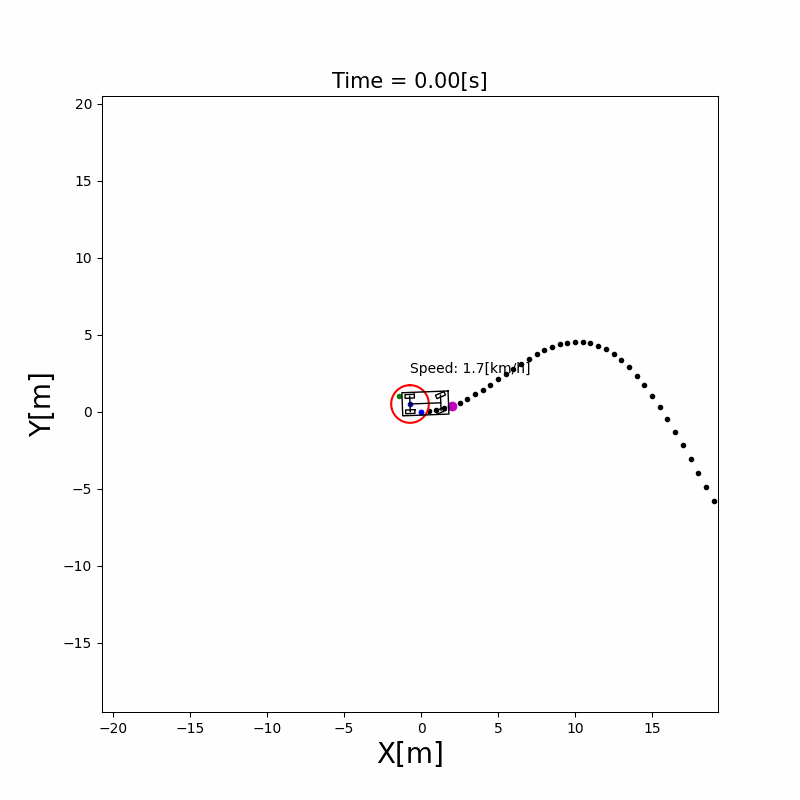
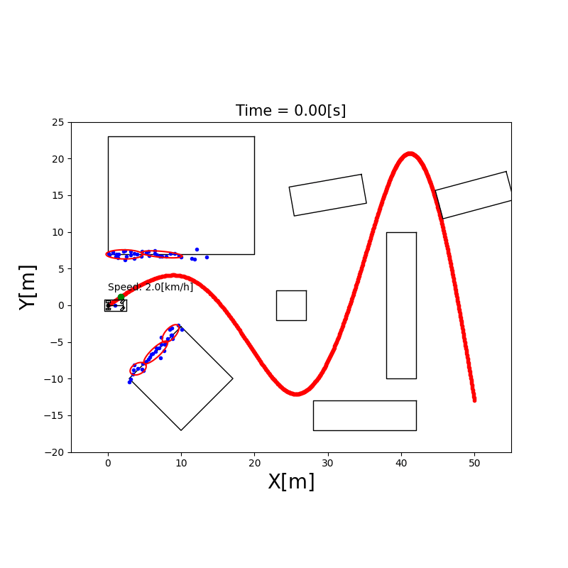
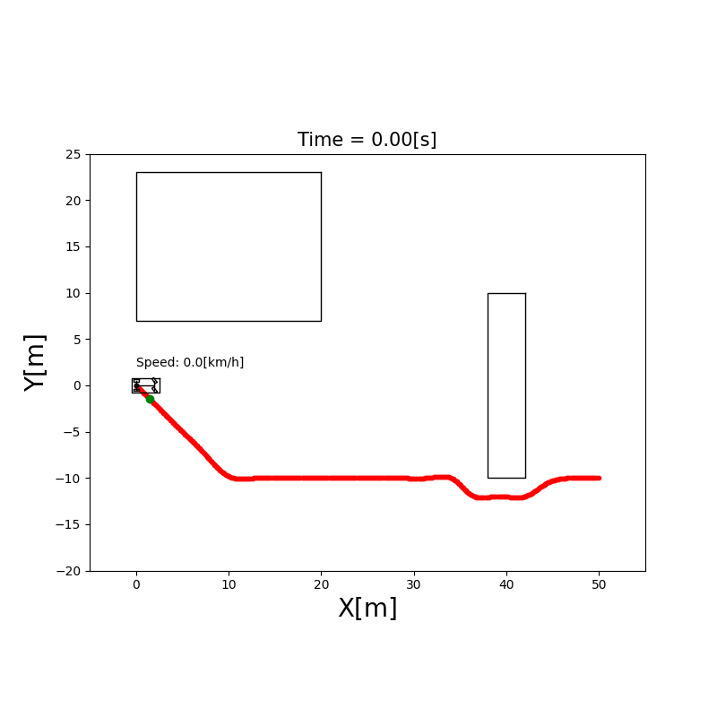

# AutonomousVehicleControlBeginnersGuide
[](https://github.com/ShisatoYano/AutonomousVehicleControlBeginnersGuide/actions/workflows/Linux_CI.yml) [](https://github.com/ShisatoYano/AutonomousVehicleControlBeginnersGuide/actions/workflows/Windows_CI.yml) [](https://github.com/ShisatoYano/AutonomousVehicleControlBeginnersGuide/actions/workflows/MacOS_CI.yml) [](https://www.codefactor.io/repository/github/shisatoyano/autonomousvehiclecontrolbeginnersguide)

Python sample codes and documents about Autonomous vehicle control algorithm. This project can be used as a technical guide book to study the algorithms and the software architectures for beginners.  

Explore localization, mapping, planning, and tracking through runnable Python simulations.

**[Browse all simulation demos](doc/EXAMPLES.md)**

<!-- featured-demos:start -->
| Localization | Mapping |
| --- | --- |
|  |  |
| **Planning** | **Tracking** |
|  |  |
<!-- featured-demos:end -->


## Table of Contents
* [What is this?](#what-is-this)
* [Goal of this project](#goal-of-this-project)
* [Requirements](#requirements)
* [Quick Start](#quick-start)
* [Examples of Simulation](#examples-of-simulation)
* [Documents](#documents)
* [License](#license)
* [Use Case](#use-case)
* [Contribution](#contribution)
* [Author](#author)


## What is this?
This is a sample codes collections about Autonomous vehicle control algorithm. Each source codes are implemented with Python to help your understanding. You can fork this repository and use for studying, education or work freely.  


## Goal of this project
We propose building a collaborative web book about autonomous vehicle algorithms using the code and documents in this repository. Help shape the book by commenting on [the web-book proposal (#165)](https://github.com/ShisatoYano/AutonomousVehicleControlBeginnersGuide/issues/165) or opening an issue with your feedback.

The next goal is a simulator where you can learn the whole navigation of an autonomous vehicle, swapping algorithms at each stage and comparing the results. See the [architecture and roadmap](/doc/ARCHITECTURE.md) and the [roadmap issue](https://github.com/ShisatoYano/AutonomousVehicleControlBeginnersGuide/issues/131).  


## Requirements
Please satisfy with the following requirements on native or VM Linux in advance.  
For running each sample codes:  
* [Python 3.13.x](https://www.python.org/)
* [Matplotlib](https://matplotlib.org/)
* [NumPy](https://numpy.org/)
* [SciPy](https://scipy.org/)
* [CasADi](https://web.casadi.org/) (for MPC path tracking)
* [do-mpc](https://www.do-mpc.com/) (for MPC path tracking)

For development:
* [pytest](https://docs.pytest.org/en/7.4.x/) (for unit tests)
* [Pillow](https://python-pillow.github.io/) (for generating the documentation social-preview image)

For setting up the environment with Docker (see [Quick Start](#quick-start)):
* [Docker](https://www.docker.com/)
* [VS Code](https://code.visualstudio.com/) with the [Dev Containers extension](https://marketplace.visualstudio.com/items?itemName=ms-vscode-remote.remote-containers) (only for option A)


## Quick Start
### 1. Clone this repository
```bash
$ git clone https://github.com/ShisatoYano/AutonomousVehicleControlBeginnersGuide
$ cd AutonomousVehicleControlBeginnersGuide
```

### 2. Set up the environment
Choose one of the following options.

Note for options A and B: The container shows the animations through your host's X11 display.
* Linux: Allow local connections to your X server before starting the container. This setting is reset when you log out, so run it again after logging in (or run it automatically at login).
    ```bash
    $ xhost +local:
    ```
    This allows any local process on your machine to connect to your X server, so be careful on a shared machine.
* Windows / macOS: You need an X server that the container can connect to, such as [WSLg](https://github.com/microsoft/wslg) on WSL2 or [XQuartz](https://www.xquartz.org/) on macOS.

#### A. VS Code + Docker (Dev Container)
1. Install [Docker](https://www.docker.com/) and [VS Code](https://code.visualstudio.com/) with the [Dev Containers extension](https://marketplace.visualstudio.com/items?itemName=ms-vscode-remote.remote-containers)
2. Open this repository's folder in VS Code
3. Run `Dev Containers: Reopen in Container` from the Command Palette
4. All required libraries are installed automatically. Run the commands in the following steps in VS Code's terminal

#### B. Docker only
1. Install [Docker](https://www.docker.com/)
2. Build and start the container, and then open a shell in it
    ```bash
    $ docker compose up -d --build
    $ docker compose exec simulation bash
    ```
3. Run the commands in the following steps in this shell. To stop the container, run `docker compose down` on your host


#### C. Local (without Docker)
1. Install [Python 3.13.x](https://www.python.org/)
2. Create a virtual environment and install the required libraries
    * Linux / macOS:
        ```bash
        $ python3 -m venv .venv
        $ source .venv/bin/activate
        $ pip install -r requirements.txt
        ```
    * Windows (PowerShell):
        ```powershell
        > python -m venv .venv
        > .venv\Scripts\Activate.ps1
        > pip install -r requirements.txt
        ```

### 3. Run a simulation
Each simulation runs with one command. For example, localization with an Extended Kalman Filter, where the vehicle estimates its position from sensor observations while following a course:
```bash
$ python src/simulations/localization/extended_kalman_filter_localization/extended_kalman_filter_localization.py
```
You can find all simulations in [doc/EXAMPLES.md](/doc/EXAMPLES.md).

### 4. (Optional) Run unit tests
You can confirm that the environment is set up correctly by running the unit tests.
```bash
$ . run_test_suites.sh
```
On Windows without Docker, run `run_test_suites.bat` instead.

Add star to this repository if you like it!!


For editor setup, see [Code completion / import resolution](/HOWTOCONTRIBUTE.md#code-completion--import-resolution-in-your-editor).


## Examples of Simulation
Every algorithm has a runnable simulation with an animated demo, organized into these categories:

* Localization
* Mapping
* Path Planning
* Path Tracking
* Perception
* Course

The full list with demo GIFs is generated from `src/simulations` — see [doc/EXAMPLES.md](/doc/EXAMPLES.md).


## Documents
Design documents of each Python programs are prepared here. The documents are still not completed. They have been being updated. If you found any problems in them, please tell me by creating an issue.  
[Documents link](/doc/DESIGN_DOCUMENT.md)  


## License
MIT  


## Use Case
I started this project to study an algorithm and software development for Autonomous Vehicle system by myself. You can also use this repo for your own studying, education, researching and development.  

If this project helps your task, please let me know by creating a issue.  
Any paper, animation, video as your output, always welcome!! It will encourage me to continue this project.  

Your comment and output is added to [this list of user comments](/USERS_COMMENTS.md).  


## Contribution
Any contribution by creating an issue or sending a pull request is welcome!! Please check [this document about how to contribute](/HOWTOCONTRIBUTE.md).  
If you are looking for a place to start, see the [good first issues](https://github.com/ShisatoYano/AutonomousVehicleControlBeginnersGuide/issues?q=is%3Aissue%20state%3Aopen%20label%3A%22good%20first%20issue%22) and the [roadmap issue](https://github.com/ShisatoYano/AutonomousVehicleControlBeginnersGuide/issues/131).  


## Author
[Shisato Yano](https://github.com/ShisatoYano)  
