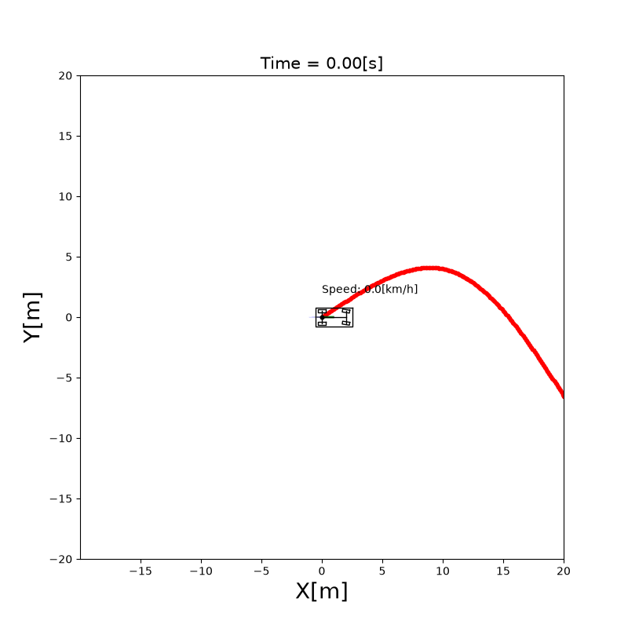
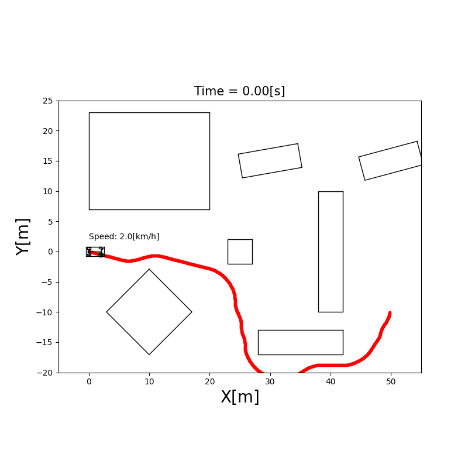
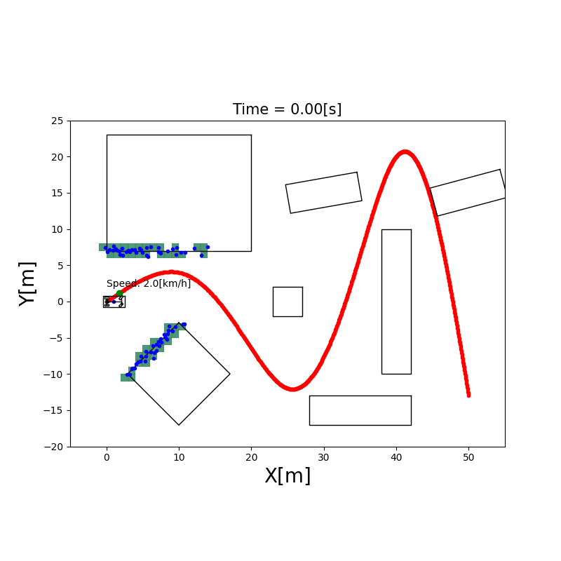
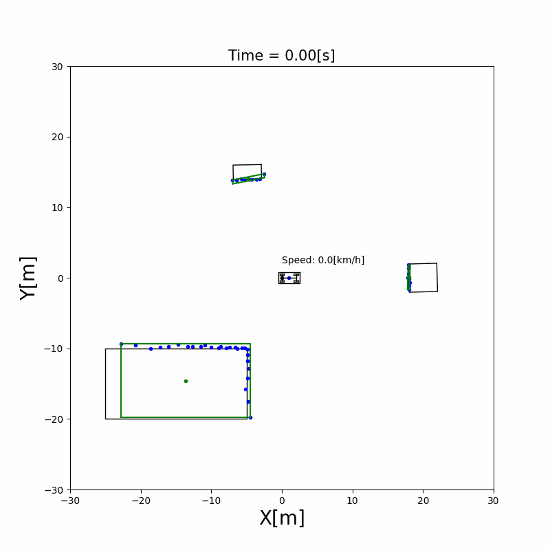

# AutonomousVehicleControlBeginnersGuide
[](https://github.com/ShisatoYano/AutonomousVehicleControlBeginnersGuide/actions/workflows/Linux_CI.yml) [](https://github.com/ShisatoYano/AutonomousVehicleControlBeginnersGuide/actions/workflows/Windows_CI.yml) [](https://github.com/ShisatoYano/AutonomousVehicleControlBeginnersGuide/actions/workflows/MacOS_CI.yml) [](https://shisatoyano.github.io/AutonomousVehicleControlBeginnersGuide/) [](https://www.codefactor.io/repository/github/shisatoyano/autonomousvehiclecontrolbeginnersguide)

**Learn autonomous driving by building it.** Python simulations and an [open textbook](https://shisatoyano.github.io/AutonomousVehicleControlBeginnersGuide/) of self-driving car algorithms (localization, mapping, path planning, path tracking, perception and control), and of the [software architecture](/doc/ARCHITECTURE.md) that connects them into one autonomous driving system. The system grows one stage at a time, and you can swap and compare the algorithms of each stage in the same system.

**[Read the book](https://shisatoyano.github.io/AutonomousVehicleControlBeginnersGuide/)** · **[See all simulations](/doc/EXAMPLES.md)** · **[Quick start](#quick-start)**

<!-- The same demos as doc/social_preview.py, which draws the social preview image from them -->
<table>
  <tr>
    <td align="center" width="33%"><br><a href="https://shisatoyano.github.io/AutonomousVehicleControlBeginnersGuide/localization/index.html">Localization: EKF vs UKF vs PF</a></td>
    <td align="center" width="33%"><br><a href="https://shisatoyano.github.io/AutonomousVehicleControlBeginnersGuide/optimal_control/mppi.html">Path tracking: MPPI</a></td>
    <td align="center" width="33%"><br><a href="https://shisatoyano.github.io/AutonomousVehicleControlBeginnersGuide/path_planning/index.html">Path planning: Hybrid A*</a></td>
  </tr>
  <tr>
    <td align="center" width="33%"><br><a href="https://shisatoyano.github.io/AutonomousVehicleControlBeginnersGuide/mapping/index.html">Mapping: NDT</a></td>
    <td align="center" width="33%"><br><a href="https://shisatoyano.github.io/AutonomousVehicleControlBeginnersGuide/mapping/index.html">Mapping: cost map</a></td>
    <td align="center" width="33%"><br><a href="https://shisatoyano.github.io/AutonomousVehicleControlBeginnersGuide/perception/index.html">Perception: rectangle fitting</a></td>
  </tr>
</table>


## Table of Contents
* [About this project](#about-this-project)
* [Requirements](#requirements)
* [Quick Start](#quick-start)
* [Examples of Simulation](#examples-of-simulation)
* [The book](#the-book)
* [License](#license)
* [Citing](#citing)
* [Use Case](#use-case)
* [Contribution](#contribution)
* [Support this project](#support-this-project)
* [Author](#author)


## About this project
Every algorithm is a small Python simulation with an animation, written to be easy to read rather than fast or complete. You can run each one with a single command, change its parameters and see what happens. Fork it and use it for studying, teaching or your own work.

Beyond single algorithms, the project shows how they work together: how the stages of an autonomous driving system pass data to each other, why the true state and the estimates are kept apart, and how small interfaces let you swap one algorithm for another. The [architecture and roadmap](/doc/ARCHITECTURE.md) explain the design, which the code is moving toward step by step (see the [roadmap issue](https://github.com/ShisatoYano/AutonomousVehicleControlBeginnersGuide/issues/131)).


## Requirements
Please satisfy with the following requirements on native or VM Linux in advance.  
For running each sample codes:  
* [Python 3.13.x](https://www.python.org/)
* [Matplotlib](https://matplotlib.org/)
* [NumPy](https://numpy.org/)
* [SciPy](https://scipy.org/)
* [CasADi](https://web.casadi.org/) (for MPC path tracking)
* [do-mpc](https://www.do-mpc.com/) (for MPC path tracking)

For development:
* [pytest](https://docs.pytest.org/en/7.4.x/) (for unit tests)

For setting up the environment with Docker (see [Quick Start](#quick-start)):
* [Docker](https://www.docker.com/)
* [VS Code](https://code.visualstudio.com/) with the [Dev Containers extension](https://marketplace.visualstudio.com/items?itemName=ms-vscode-remote.remote-containers) (only for option A)


## Quick Start
### 1. Clone this repository
```bash
$ git clone https://github.com/ShisatoYano/AutonomousVehicleControlBeginnersGuide
$ cd AutonomousVehicleControlBeginnersGuide
```

### 2. Set up the environment
Choose one of the following options.

Note for options A and B: The container shows the animations through your host's X11 display.
* Linux: Allow local connections to your X server before starting the container. This setting is reset when you log out, so run it again after logging in (or run it automatically at login).
    ```bash
    $ xhost +local:
    ```
    This allows any local process on your machine to connect to your X server, so be careful on a shared machine.
* Windows / macOS: You need an X server that the container can connect to, such as [WSLg](https://github.com/microsoft/wslg) on WSL2 or [XQuartz](https://www.xquartz.org/) on macOS.

#### A. VS Code + Docker (Dev Container)
1. Install [Docker](https://www.docker.com/) and [VS Code](https://code.visualstudio.com/) with the [Dev Containers extension](https://marketplace.visualstudio.com/items?itemName=ms-vscode-remote.remote-containers)
2. Open this repository's folder in VS Code
3. Run `Dev Containers: Reopen in Container` from the Command Palette
4. All required libraries are installed automatically. Run the commands in the following steps in VS Code's terminal

#### B. Docker only
1. Install [Docker](https://www.docker.com/)
2. Build and start the container, and then open a shell in it
    ```bash
    $ docker compose up -d --build
    $ docker compose exec simulation bash
    ```
3. Run the commands in the following steps in this shell. To stop the container, run `docker compose down` on your host


#### C. Local (without Docker)
1. Install [Python 3.13.x](https://www.python.org/)
2. Create a virtual environment and install the required libraries
    * Linux / macOS:
        ```bash
        $ python3 -m venv .venv
        $ source .venv/bin/activate
        $ pip install -r requirements.txt
        ```
    * Windows (PowerShell):
        ```powershell
        > python -m venv .venv
        > .venv\Scripts\Activate.ps1
        > pip install -r requirements.txt
        ```

### 3. Run a simulation
Each simulation runs with one command. For example, localization with an Extended Kalman Filter, where the vehicle estimates its position from sensor observations while following a course:
```bash
$ python src/simulations/localization/extended_kalman_filter_localization/extended_kalman_filter_localization.py
```
You can find all simulations in [doc/EXAMPLES.md](/doc/EXAMPLES.md).

### 4. (Optional) Run unit tests
You can confirm that the environment is set up correctly by running the unit tests.
```bash
$ . run_test_suites.sh
```
On Windows without Docker, run `run_test_suites.bat` instead.

Add star to this repository if you like it!!


## Examples of Simulation
Every algorithm has a runnable simulation with an animated demo, in these categories: localization, mapping, path planning, path tracking, perception and course generation. The full list with the demo GIFs is generated from `src/simulations`: see [doc/EXAMPLES.md](/doc/EXAMPLES.md).


## The book
The explanations are published as a free web book: **[https://shisatoyano.github.io/AutonomousVehicleControlBeginnersGuide/](https://shisatoyano.github.io/AutonomousVehicleControlBeginnersGuide/)**. Each chapter adds one stage to the system, and explains the theory with equations and figures, where each equation lives in the code, and experiments to try. It is being written in the open (see the [documentation roadmap](https://github.com/ShisatoYano/AutonomousVehicleControlBeginnersGuide/issues/165)). Comments and ideas are welcome in the [Book](https://github.com/ShisatoYano/AutonomousVehicleControlBeginnersGuide/discussions/categories/book) category of Discussions, and anyone can help write a chapter: see the [writing guide](https://shisatoyano.github.io/AutonomousVehicleControlBeginnersGuide/WRITING_GUIDE.html).


## License
MIT  


## Citing
If you use this project in your research or teaching, please cite it. Click "Cite this repository" on the right side of the repository page to get the citation in APA or BibTeX format, or see [CITATION.cff](/CITATION.cff).  


## Use Case
I started this project to study an algorithm and software development for Autonomous Vehicle system by myself. You can also use this repo for your own studying, education, researching and development.  

If this project helps your task, please let me know in [Show and tell](https://github.com/ShisatoYano/AutonomousVehicleControlBeginnersGuide/discussions/categories/show-and-tell).  
Any paper, animation, video as your output, always welcome!! It will encourage me to continue this project.  

Your comment and output is added to [this list of user comments](/USERS_COMMENTS.md).  


## Contribution
Any contribution by creating an issue or sending a pull request is welcome!! Please check [this document about how to contribute](/HOWTOCONTRIBUTE.md).  
Questions about the algorithms or the code are welcome in [Q&A](https://github.com/ShisatoYano/AutonomousVehicleControlBeginnersGuide/discussions/categories/q-a), and feedback on the book in [Book](https://github.com/ShisatoYano/AutonomousVehicleControlBeginnersGuide/discussions/categories/book).  
If you are looking for a place to start, see the [good first issues](https://github.com/ShisatoYano/AutonomousVehicleControlBeginnersGuide/issues?q=is%3Aissue%20state%3Aopen%20label%3A%22good%20first%20issue%22) and the [roadmap issue](https://github.com/ShisatoYano/AutonomousVehicleControlBeginnersGuide/issues/131).  


## Support this project
This project is free and will stay free. If it helps you, you can support it through [GitHub Sponsors](https://github.com/sponsors/ShisatoYano). Your sponsorship pays for:
- Time to write the [web book](https://shisatoyano.github.io/AutonomousVehicleControlBeginnersGuide/) ([#165](https://github.com/ShisatoYano/AutonomousVehicleControlBeginnersGuide/issues/165))
- Time to add algorithms and grow the code into a full navigation system ([#131](https://github.com/ShisatoYano/AutonomousVehicleControlBeginnersGuide/issues/131))
- Time to review pull requests and keep the project maintained

Sponsors are thanked by name on the book's [acknowledgments page](https://shisatoyano.github.io/AutonomousVehicleControlBeginnersGuide/ACKNOWLEDGMENTS.html) and, depending on the [tier](https://github.com/sponsors/ShisatoYano), also here in the README; corporate sponsors with their logo. Only public sponsors are listed; if you'd rather not be listed, just tell me. Sponsorship doesn't include individual support: questions are answered for everyone in [Q&A](https://github.com/ShisatoYano/AutonomousVehicleControlBeginnersGuide/discussions/categories/q-a).

### Sponsors
No sponsors yet. [Be the first one!](https://github.com/sponsors/ShisatoYano)


## Author
[Shisato Yano](https://github.com/ShisatoYano)  
