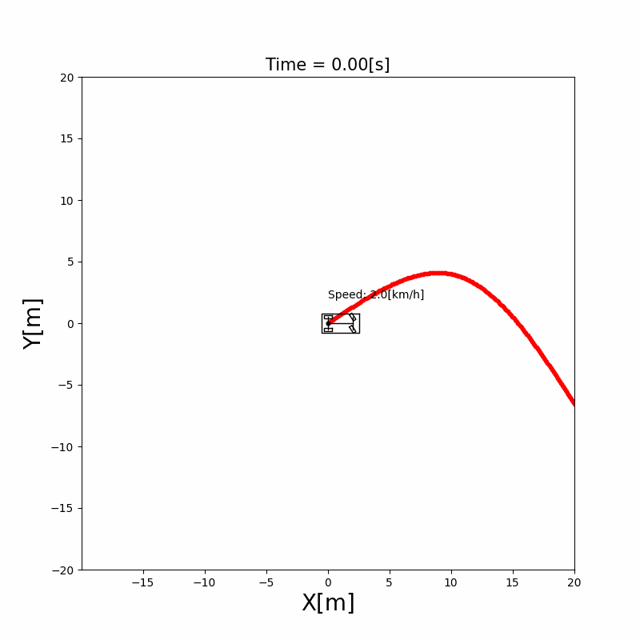

# 4.1 Stanley Controller

The Stanley controller steers a vehicle along a reference course by looking at two errors at the front axle: how far the axle is from the course, and how much the vehicle's heading differs from the course's direction. After this chapter, you can compute its steering angle by hand and change its gain in the simulation.

## Problem and intuition

A path tracking controller has to decide the steering angle at every time step so that the vehicle follows a given course. The Stanley controller was used by Stanford's car "Stanley", which won the DARPA Grand Challenge in 2005 [1].

It combines two simple ideas:

- **Align with the course.** If the vehicle points in a different direction from the course, turn the wheels by that difference.
- **Steer back toward the course.** If the front axle is off to one side, turn toward the course. The farther away, the more you turn, but the faster you drive, the less you turn, so the vehicle doesn't swerve at high speed.

Both are measured at the **front axle**, because the front wheels are the ones that steer.



## Theory

The symbols follow [Notation and Units](../NOTATION.md).

**Front axle position.** The vehicle's state $(x, y, \theta, v)$ is given at the rear axle. The front axle is the wheelbase $L$ ahead along the heading:

$$
x_f = x + L\cos\theta, \qquad y_f = y + L\sin\theta \tag{1}
$$

**Errors.** Let $(x_r, y_r, \theta_r)$ be the point on the course nearest to the front axle and the course's yaw there. The heading error $\theta_e$ and the lateral error $e$ are

$$
\theta_e = \theta - \theta_r, \qquad
e = -\sin\theta\,(x_f - x_r) + \cos\theta\,(y_f - y_r) \tag{2}
$$

$e$ is the front axle's offset from the course point, measured along the vehicle's left direction: it is positive when the axle is on the left of the course.

**Steering law.** The steering angle $\delta$ (positive to the left) is

$$
\delta = -\left(\theta_e + \arctan\frac{k\,e}{v}\right) \tag{3}
$$

- The first term turns the wheels back by the heading error. If the vehicle points 0.1 rad to the left of the course, the wheels turn 0.1 rad to the right.
- The second term steers toward the course. For a small offset, $\arctan(k e / v) \approx k e / v$: the correction grows with the offset and shrinks with the speed. For a large offset it saturates at $\pi/2$, so the vehicle heads straight for the course instead of turning more and more.

The minus sign comes from the sign convention of (2): both errors are positive when the vehicle is to the left of or turned to the left of the course, and the correction turns right. Snider [2] defines the errors with the opposite signs and writes the same law without the minus sign.

**Yaw rate.** The vehicle model of this project takes a yaw rate as its input, so the steering angle is turned into a yaw rate with the kinematic bicycle model:

$$
\omega = \frac{v \tan\delta}{L} \tag{4}
$$

**Speed.** The speed follows the course's target speed $v_r$ with a proportional controller, $a = k_v (v_r - v)$.

## Algorithm

```text
At every time step, given the state (x, y, theta, v) at the rear axle:
1. Compute the front axle position with (1)
2. Find the course point nearest to the front axle
3. Compute the heading error and the lateral error with (2)
4. Compute the steering angle with (3), using 0 for the arctan term when v = 0
5. Compute the yaw rate with (4), and the acceleration from the target speed
```

## Limits

- **Low speed.** $k e / v$ grows without bound as $v \to 0$, so the steering can jump at very low speed. The original paper adds a softening constant, $\arctan(k e / (k_s + v))$ [1]. This implementation has no softening constant, and only skips the term when $v = 0$.
- **Gain tuning.** A small $k$ returns to the course slowly. A large $k$ returns quickly but can oscillate.
- **Lateral error in the vehicle's frame.** (2) measures the offset along the vehicle's left direction, not perpendicular to the course. The two agree when the heading error is small, which is the normal case while tracking.
- **Kinematic model only.** The law ignores tire slip and actuator delay. The paper adds terms for them at high speed [1].

## Where the equations live in the code

The controller is `StanleyController` in `src/components/control/stanley/stanley_controller.py`. Its `update()` runs the five steps of the algorithm:

```{literalinclude} ../../src/components/control/stanley/stanley_controller.py
:language: python
:pyobject: StanleyController.update
```

Equation (1), the front axle position:

```{literalinclude} ../../src/components/control/stanley/stanley_controller.py
:language: python
:pyobject: StanleyController._calculate_front_axle_state
```

Equation (2) is computed by the course, which knows the target point. `error_yaw_rad` is $\theta_e$ and `error_lat_m` is $e$:

```{literalinclude} ../../src/components/course/cubic_spline_course/cubic_spline_course.py
:language: python
:pyobject: CubicSplineCourse.calculate_lonlat_error
```

Equations (3) and (4). `CONTROL_GAIN` is $k$, and `atan2(k e, v)` equals $\arctan(k e / v)$ for $v > 0$:

```{literalinclude} ../../src/components/control/stanley/stanley_controller.py
:language: python
:pyobject: StanleyController._calculate_control_input
```

## Experiments

Run the simulation `src/simulations/path_tracking/stanley_path_tracking/stanley_path_tracking.py`, and change `self.CONTROL_GAIN` in the constructor of `StanleyController` (0.5 by default):

- With 0.1, the vehicle comes back to the course slowly after the curves.
- With 2.0, it comes back quickly. Watch whether it starts to weave around the course.

## Exercises

1. A vehicle drives at $v = 5$ m/s with its front axle $e = 1$ m to the left of a straight course, pointing along the course ($\theta_e = 0$). With $k = 0.5$, compute $\delta$ with (3). Then compute it for $v = 1$ m/s. Why does the vehicle steer harder at the lower speed?
2. Add the softening constant $k_s$ of the original paper to `_calculate_control_input()`, and check how the steering behaves when the simulation starts from rest.
3. Run the Pure Pursuit simulation (`src/simulations/path_tracking/pure_pursuit_path_tracking`) on the same course, and compare how closely the two controllers follow the curves.

## References

1. G. M. Hoffmann, C. J. Tomlin, M. Montemerlo and S. Thrun, "Autonomous Automobile Trajectory Tracking for Off-Road Driving: Controller Design, Experimental Validation and Racing", American Control Conference, 2007. [PDF](https://ai.stanford.edu/~gabeh/papers/hoffmann_stanley_control07.pdf)
2. J. M. Snider, "Automatic Steering Methods for Autonomous Automobile Path Tracking", Technical Report CMU-RI-TR-09-08, Carnegie Mellon University, 2009. [PDF](https://www.ri.cmu.edu/pub_files/2009/2/Automatic_Steering_Methods_for_Autonomous_Automobile_Path_Tracking.pdf)
