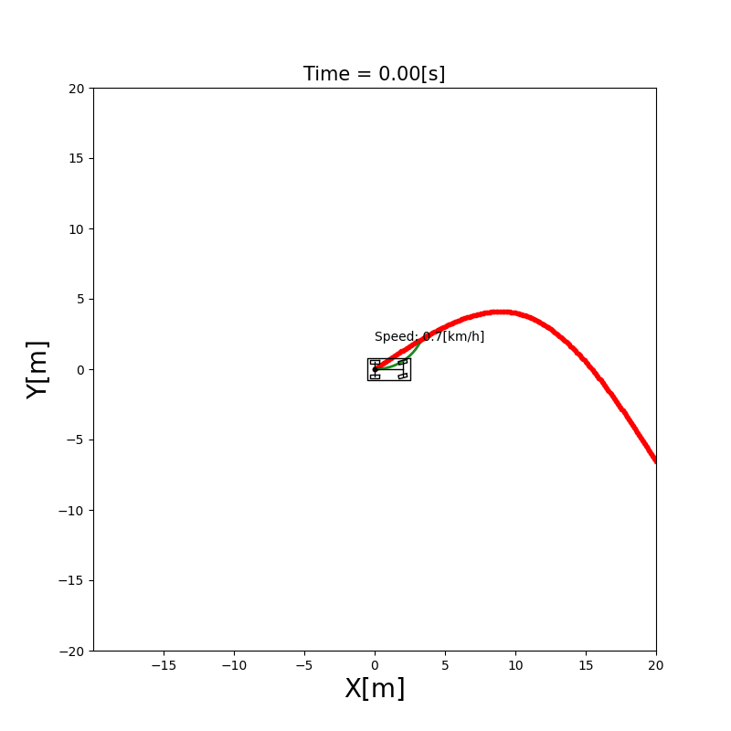
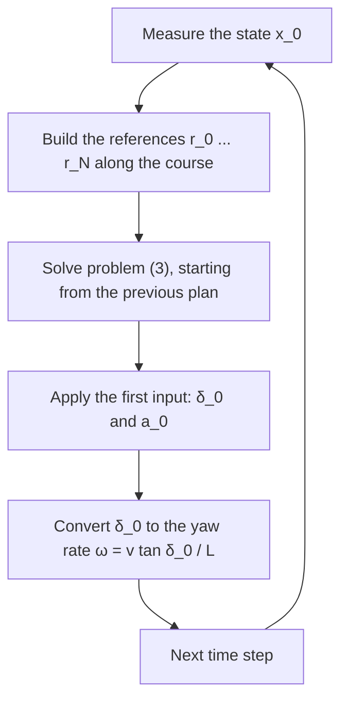

# 10.3 Model Predictive Control (MPC)

Model predictive control (MPC) for path tracking explained: the kinematic bicycle model, the cost and the constraints, with Python code using CasADi and do-mpc. Model predictive control computes the steering angle and the acceleration by **predicting** the vehicle's motion a few seconds ahead with the kinematic bicycle model, and choosing the inputs that make that prediction follow the course best while respecting the vehicle's limits. After this section, you can write down the optimization problem that the MPC controller solves at every step, and know which part of it each parameter changes.

## Problem and intuition

The geometric controllers of [Chapter 4](../path_tracking/index.md) look at the error **now**, and react to it. A curve that starts in two seconds doesn't affect them until the vehicle is in it. They also produce any steering angle the formula gives, and the limits are applied afterward by clipping.

MPC plans instead:

1. **Predict.** From the current state, simulate the vehicle $N$ steps ahead for a candidate sequence of inputs.
2. **Optimize.** Find the input sequence whose prediction stays closest to the course, with small and smooth inputs, and never exceeds the limits.
3. **Apply the first input only.** Then, at the next step, measure the state again and plan again from there.

Because the plan is redone at every step from the measured state, errors of the model and disturbances are corrected, like in a feedback controller. This is the **receding horizon** principle: the horizon of $N$ steps moves forward with the vehicle.



**Run it** from the repository root: `python src/simulations/path_tracking/mpc_path_tracking/mpc_path_tracking.py` ([code on GitHub](/src/simulations/path_tracking/mpc_path_tracking))

## Theory

The symbols follow [Notation and Units](../NOTATION.md). Inside the horizon, the steps are counted with $k = 0, 1, \dots, N$ from the current state $\mathbf{x}_0$.

**The prediction model.** MPC uses the kinematic bicycle model of [Chapter 3](../vehicle_model/index.md), with the **steering angle** as input, $\mathbf{u}_k = [\delta_k, a_k]^\top$, discretized with the Euler method:

\begin{equation*}
\begin{aligned}
x_{k+1} &= x_k + v_k \cos\theta_k\, \Delta t \\
y_{k+1} &= y_k + v_k \sin\theta_k\, \Delta t \\
\theta_{k+1} &= \theta_k + \frac{v_k \tan\delta_k}{L}\, \Delta t \\
v_{k+1} &= v_k + a_k\, \Delta t
\end{aligned} \tag{1}
\end{equation*}

We write it as $\mathbf{x}_{k+1} = f(\mathbf{x}_k, \mathbf{u}_k)$. It is slightly simpler than the simulator's update, equation (4) of Chapter 3, which also adds $\frac{1}{2} a_k \Delta t^2$ to the distance; the difference is part of the model error that the receding horizon corrects.

**The reference.** For every step $k$, the reference $\mathbf{r}_k = [x_{r,k}, y_{r,k}, \theta_{r,k}, v_{r,k}]^\top$ is the course point at the distance $k\, v\, \Delta t$ ahead of the point nearest to the vehicle, where $v$ is the current speed (at least 1 m/s). So the reference moves along the course as fast as the vehicle does.

**The cost.** The tracking error at step $k$ is $\mathbf{e}_k = \mathbf{x}_k - \mathbf{r}_k$, with the heading error wrapped into $[-\pi, \pi)$. The cost of a plan adds up the weighted squared errors and the changes of the input, with a separate weight at the end of the horizon:

$$
J = \sum_{k=0}^{N-1} \left( \mathbf{e}_k^\top W \mathbf{e}_k + \Delta\mathbf{u}_k^\top W_\Delta\, \Delta\mathbf{u}_k \right) + \mathbf{e}_N^\top W_N\, \mathbf{e}_N,
\qquad \Delta\mathbf{u}_k = \mathbf{u}_k - \mathbf{u}_{k-1} \tag{2}
$$

where $W$, $W_N$ and $W_\Delta$ are diagonal matrices of weights, and $\mathbf{u}_{-1}$ is the input applied in the previous step. Many books write the weights as $Q$ and $R$; this book uses $W$, because $Q$ and $R$ are the noise covariances of the estimation chapters.

- $W = \mathrm{diag}(w_x, w_y, w_\theta, w_v)$ trades position, heading and speed errors against each other.
- $W_N$, the **terminal weight**, makes the plan end in a good state. Without it, the optimizer could choose a plan that is fine for $N$ steps but heads off the course right after.
- $W_\Delta$ penalizes changes of the steering angle and the acceleration, which makes the steering smooth.

**The optimization problem.** At every step, the controller solves

$$
\min_{\mathbf{u}_0, \dots, \mathbf{u}_{N-1}} J
\quad \text{subject to} \quad
\mathbf{x}_{k+1} = f(\mathbf{x}_k, \mathbf{u}_k),\;
|\delta_k| \le \delta_{\max},\;
|a_k| \le a_{\max},\;
v_{\min} \le v_k \le v_{\max} \tag{3}
$$

The limits are **hard constraints**: the solver only returns plans that satisfy them, so the steering angle is never clipped afterward.

**Solving it.** Because of $\cos\theta$, $\sin\theta$ and $\tan\delta$ in (1), problem (3) is a **nonlinear program**. The controller solves it numerically with IPOPT, an interior point solver, which needs the derivatives of the cost and the constraints. These are computed exactly from the symbolic expressions by CasADi, and the library do-mpc builds the whole problem over the horizon. Each solve starts from the previous plan shifted by one step (a **warm start**), which is already close to the new solution.

## Algorithm



The vehicle in the simulator takes the yaw rate as input, so the steering angle is converted with equation (3) of [Chapter 3](../vehicle_model/index.md#32-steering-angle-or-yaw-rate).

The simulation [`mpc_path_tracking`](/src/simulations/path_tracking/mpc_path_tracking) uses $\Delta t = 0.1$ s and $N = 20$ (2 s ahead), the weights $W = W_N = \mathrm{diag}(50, 50, 1, 20)$, the limits $\delta_{\max} = 0.523$ rad (30°) and $a_{\max} = 2$ m/s², and the speeds $0 \le v \le 15$ m/s.

## Limits

- **Computation.** A nonlinear program is solved at every step. In `mpc_path_tracking`, one solve took 14 ms (median) and up to 47 ms in a run on a PC, far more than the formula of a geometric controller, and it grows with the horizon.
- **Local minima.** The solver finds a plan where the cost doesn't decrease any more nearby, which is not always the best plan. The warm start helps it stay near a good solution.
- **The model has to be right.** The plan is only as good as the prediction. A model that ignores tire slip ([Chapter 14](../dynamic_vehicle_model/index.md)) predicts wrongly at high speed, and the constraints are then satisfied only for the model, not for the vehicle.
- **Stopping at the goal is outside the optimization.** Near the end of the course, the controller lowers the reference speed and, in the last meters, overrides the acceleration to brake and stop. These rules are in `update()`, not in problem (3).

## Where the equations live in the code

The model (1) is declared symbolically, so CasADi can differentiate it:

```{literalinclude} ../../src/components/control/mpc/mpc_controller.py
:language: python
:pyobject: MPCController._build_model
```

The cost (2) and the constraints (3) are set in `_build_mpc()`. `lterm` is the sum over the steps, `mterm` the terminal term, and `set_rterm()` the penalty on the input changes:

```{literalinclude} ../../src/components/control/mpc/mpc_controller.py
:language: python
:pyobject: MPCController._build_mpc
```

`set_rterm()` gets the sum of `control_cost_weight` and `smoothness_cost_weight`, and both act on the change of the input $\Delta\mathbf{u}_k$: the code has no separate penalty on the size of the input.

## Experiments

Change the parameters of `MPCController` in `mpc_path_tracking.py` and compare the distance from the vehicle to the course. With the settings above it is 0.13 m on average.

- **A short horizon.** With `horizon_step_T=5` (0.5 s ahead), the plan sees the next curve too late: the average distance grows to 0.19 m and the largest to 2.4 m (1.0 m with $N = 20$).
- **No terminal weight.** With the terminal weights set to almost zero, the tracking hardly changes (0.14 m on average). With a 2 s horizon, the last step is far enough ahead that it barely affects the first input. Try it again with a short horizon.
- **Smoother steering.** Multiply the steering weight of `smoothness_cost_weight` by ten. The step-to-step change of the steering angle drops by about 40 %, while the distance to the course stays almost the same.

## References

1. J. B. Rawlings, D. Q. Mayne and M. M. Diehl, "Model Predictive Control: Theory, Computation, and Design", 2nd ed., Nob Hill Publishing, 2017.
2. A. Wächter and L. T. Biegler, "On the Implementation of an Interior-Point Filter Line-Search Algorithm for Large-Scale Nonlinear Programming", Mathematical Programming, 106(1), 2006. (IPOPT)
3. J. A. E. Andersson, J. Gillis, G. Horn, J. B. Rawlings and M. Diehl, "CasADi: A Software Framework for Nonlinear Optimization and Optimal Control", Mathematical Programming Computation, 11(1), 2019.
4. F. Fiedler et al., "do-mpc: Towards FAIR Nonlinear and Robust Model Predictive Control", Control Engineering Practice, 140, 2023.

The MPC controller and the first version of this section were written by Mohit Kumar.
