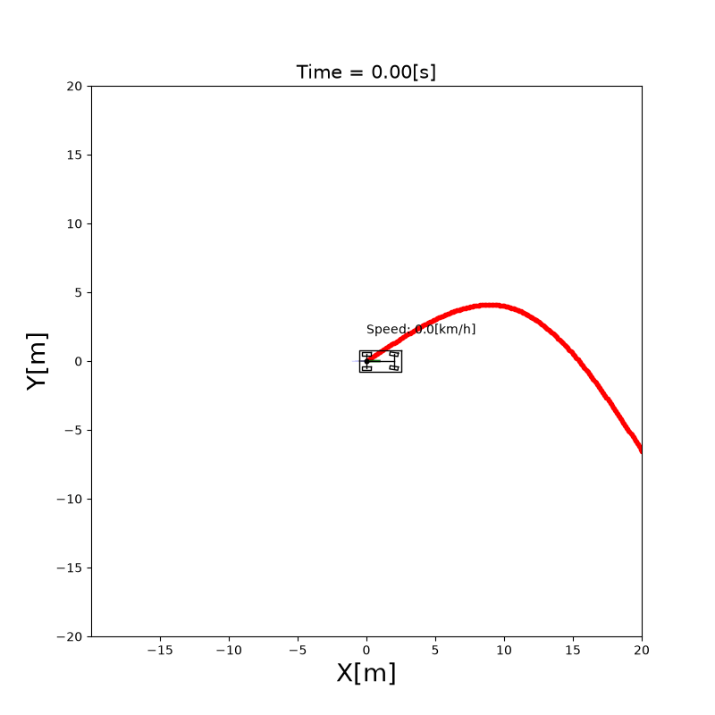
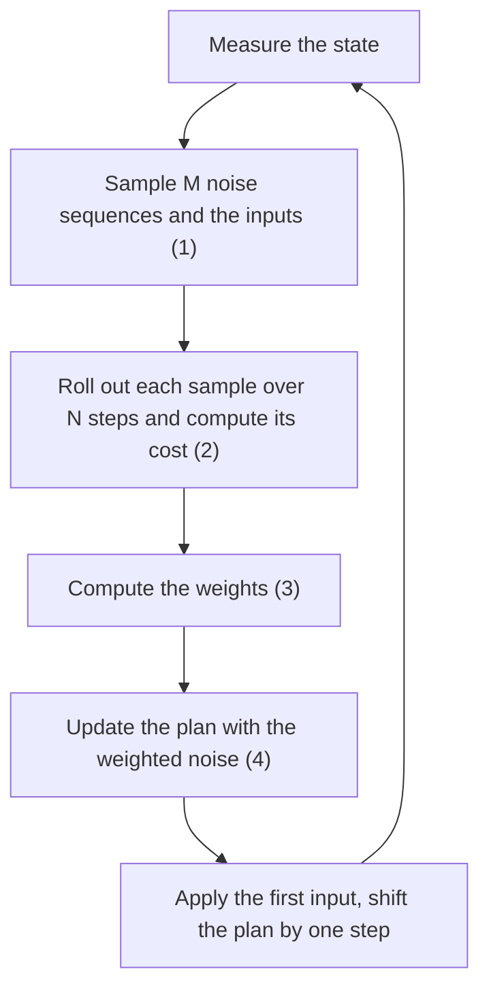

# 10.4 Model Predictive Path Integral Control (MPPI)

Model predictive path integral (MPPI) control explained: sampling, weighting and updating the plan, with a Python path tracking simulation and a comparison with MPC. MPPI plans like MPC, over a horizon with the vehicle's model, but it doesn't solve an optimization problem. It **samples** many input sequences around its current plan, simulates each one, and moves the plan toward the samples that tracked the course best. After this section, you can compute one MPPI update by hand for a few samples, and know what the temperature $\lambda$ and the noise $\Sigma$ change.

## Problem and intuition

MPC ([10.3](mpc.md)) needs a solver and the derivatives of the cost and the model. That rules out costs that are not smooth, such as "1 if the vehicle hits an obstacle, 0 otherwise", and the solver can get stuck in a local minimum.

MPPI only needs to **simulate** the model and **evaluate** the cost:

1. **Sample.** Add random noise to the current plan, a sequence of $N$ inputs, to get $M$ different candidate sequences.
2. **Roll out.** Simulate the vehicle over the horizon with each candidate, and compute the cost of each trajectory.
3. **Weight.** Give each candidate a weight that is large when its cost is low.
4. **Update.** Add the weighted average of the noises to the plan. Apply its first input, shift it by one step, and repeat at the next step.

The update is a weighted average, so no derivative is needed, and the cost can be any function that the code can evaluate.

```{figure} figures/mppi_samples.svg
:alt: A vehicle at the origin heading along the x axis, with a course on the line y = 2. Sixty thin trajectories fan out from the vehicle; those that turn toward the course are drawn darker. A thick line, the trajectory of the weighted update, bends toward the course.

One MPPI update from a plan that goes straight ahead. The samples that turn toward the course (dashed) have low cost and large weights, so the updated plan turns toward it too.
```



**Run it** from the repository root: `python src/simulations/path_tracking/mppi_path_tracking/mppi_path_tracking.py` ([code on GitHub](/src/simulations/path_tracking/mppi_path_tracking))

## Theory

The symbols follow [Notation and Units](../NOTATION.md) and [10.3](mpc.md): $k = 0, \dots, N$ counts the steps of the horizon, and the input is $\mathbf{u}_k = [\delta_k, a_k]^\top$. The plan is the sequence $\mathbf{u}_0, \dots, \mathbf{u}_{N-1}$, and the samples are counted with $i = 1, \dots, M$.

**Sampling.** Each sample perturbs the whole plan with Gaussian noise, and clips the result to the limits $|\delta| \le \delta_{\max}$, $|a| \le a_{\max}$:

\begin{equation*}
\mathbf{v}_{i,k} = \operatorname{clip}\left(\mathbf{u}_k + \boldsymbol{\varepsilon}_{i,k}\right),
\qquad \boldsymbol{\varepsilon}_{i,k} \sim \mathcal{N}(\mathbf{0}, \Sigma),
\qquad \Sigma = \begin{bmatrix} \sigma_\delta^2 & 0 \\ 0 & \sigma_a^2 \end{bmatrix} \tag{1}
\end{equation*}

A small share of the samples (`param_exploration`) uses the noise alone, $\mathbf{v}_{i,k} = \operatorname{clip}(\boldsymbol{\varepsilon}_{i,k})$, so the controller can find a plan far from the current one.

**Cost of a sample.** Each $\mathbf{v}_{i,0}, \dots, \mathbf{v}_{i,N-1}$ is rolled out from the current state with the model of [Chapter 3](../vehicle_model/index.md), giving the states $\mathbf{x}_{i,1}, \dots, \mathbf{x}_{i,N}$. The cost of the sample is

$$
J_i = \sum_{k=0}^{N-1} \left( \mathbf{e}_{i,k}^\top W \mathbf{e}_{i,k} + \gamma\, \mathbf{u}_k^\top \Sigma^{-1} \mathbf{v}_{i,k} \right) + \mathbf{e}_{i,N}^\top W_N\, \mathbf{e}_{i,N} \tag{2}
$$

- $\mathbf{e}_{i,k}$ is the error between $\mathbf{x}_{i,k}$ and the course point **nearest** to it, with the heading error wrapped into $[-\pi, \pi)$. Unlike MPC, the reference doesn't depend on time: a sample is good if it stays on the course and at the course's speed.
- $W$ and $W_N$ are the weights of the errors, as in MPC.
- The second term is the control cost of the MPPI theory [1], with $\gamma = \lambda (1 - \alpha)$. With $\alpha = 1$ it vanishes; `mppi_path_tracking` uses $\alpha = 0.98$.

**Weights.** The weight of a sample falls exponentially with its cost:

$$
w_i = \frac{\exp\left(-\frac{1}{\lambda}(J_i - \rho)\right)}{\sum_{j=1}^{M} \exp\left(-\frac{1}{\lambda}(J_j - \rho)\right)},
\qquad \rho = \min_j J_j \tag{3}
$$

The weights add up to 1. Subtracting the smallest cost $\rho$ doesn't change them (it cancels in the fraction), but keeps $\exp$ from underflowing to zero for every sample when the costs are large.

The **temperature** $\lambda$ sets how selective the weights are. With a small $\lambda$, the best sample gets almost all the weight. With a large $\lambda$, all the samples get nearly the same weight, and the update becomes a plain average of the noises, close to zero.

**Update.** The plan moves by the weighted average of the noises:

$$
\mathbf{u}_k \leftarrow \operatorname{clip}\left(\mathbf{u}_k + \sum_{i=1}^{M} w_i\, \boldsymbol{\varepsilon}_{i,k}\right), \qquad k = 0, \dots, N-1 \tag{4}
$$

The sum uses the noise $\boldsymbol{\varepsilon}_{i,k}$ before clipping, not the clipped $\mathbf{v}_{i,k} - \mathbf{u}_k$. The weighted noise can also be smoothed along $k$ with a moving average (`moving_average_window`), which makes the steering less jittery.

Then $\mathbf{u}_0$ is applied, and the plan is shifted by one step for the next update: $\mathbf{u}_k \leftarrow \mathbf{u}_{k+1}$, with the last input kept as it is.

**Where the name comes from.** Equations (3) and (4) come from the path integral formulation of stochastic optimal control: with noise on the inputs, the optimal inputs are an average over trajectories weighted by $\exp(-J/\lambda)$, and sampling approximates that average [1, 2].

## Algorithm



The simulation [`mppi_path_tracking`](/src/simulations/path_tracking/mppi_path_tracking) uses $M = 200$ samples over $N = 22$ steps of 0.1 s, $\lambda = 50$, $\sigma_\delta = 0.2$ rad and $\sigma_a = 0.8$ m/s², the same weights and limits as the MPC of 10.3, and fixes the random seed.

## MPC vs MPPI

| | MPC (10.3) | MPPI (10.4) |
|---|---|---|
| How the plan is found | A solver minimizes the cost | A weighted average of sampled plans |
| What it needs | Derivatives of the model and the cost | Only running the model and the cost |
| Limits of the inputs | Hard constraints | Clipping of the samples and the plan |
| Limits of the states (speed) | Hard constraints | Only through the cost |
| Computation | One nonlinear program per step | $M \times N$ model steps per step, easy to run in parallel |
| Result | Deterministic | Random, unless the seed is fixed |

## Limits

- **Computation in Python.** Every update simulates $M \times N = 4400$ steps and searches the nearest of the 1026 course points for each. In plain Python loops one update took more than a second in our runs, about a hundred times the MPC solve of 10.3, so `mppi_path_tracking` runs much slower than real time. MPPI is fast when the samples are computed in parallel, for example with NumPy arrays or on a GPU.
- **Sample quality.** Few samples, or noise that is too small to reach a good plan, give a noisy and poor update. Noise that is too large wastes most samples.
- **Soft constraints only.** States can only be limited through the cost: a high cost for leaving the road makes it unlikely, not impossible.
- **Tuning.** $\lambda$, $\Sigma$ and $M$ interact, and there is no simple rule to choose them.

## Where the equations live in the code

The weights (3):

```{literalinclude} ../../src/components/control/mppi/mppi_controller.py
:language: python
:pyobject: MppiController._compute_weights
```

The sampling (1), the rollouts and costs (2), and the update (4) are in `update()`:

```{literalinclude} ../../src/components/control/mppi/mppi_controller.py
:language: python
:pyobject: MppiController.update
:end-before: if self.visualize_optimal_traj
```

## Experiments

Change the parameters of `MppiController` in `mppi_path_tracking.py` and compare the distance from the vehicle to the course, and how much the steering angle changes from one step to the next. With the settings above, the distance is 0.16 m on average and 1.3 m at most.

| Change | Average distance | Largest distance | Step-to-step change of the steering |
|---|---|---|---|
| None | 0.16 m | 1.3 m | 0.064 rad |
| Fewer samples, $M = 50$ | 0.36 m | 2.3 m | 0.110 rad |
| Low temperature, $\lambda = 5$ | 0.18 m | 0.8 m | 0.146 rad |
| High temperature, $\lambda = 500$ | 0.42 m | 2.0 m | 0.034 rad |
| No moving average | 0.17 m | 1.0 m | 0.202 rad |

(The step-to-step change is the root mean square of the difference between consecutive steering angles.)

- **Fewer samples** make the weighted average noisier: the vehicle drifts farther from the course and the steering jitters.
- **A low temperature** lets the best few samples decide, so the vehicle reacts strongly and the steering jumps. **A high temperature** averages almost all the samples, the noise cancels out, and the plan barely moves: smooth, but late in the curves.
- **Without the moving average**, the steering changes three times as much from step to step, with about the same tracking.

## References

1. G. Williams, P. Drews, B. Goldfain, J. M. Rehg and E. A. Theodorou, "Information-Theoretic Model Predictive Control: Theory and Applications to Autonomous Driving", IEEE Transactions on Robotics, 34(6), 2018.
2. G. Williams, P. Drews, B. Goldfain, J. M. Rehg and E. A. Theodorou, "Aggressive Driving with Model Predictive Path Integral Control", IEEE International Conference on Robotics and Automation (ICRA), 2016.

The MPPI controller was written by Erwin Lejeune, and the first version of this section by Mohit Kumar.
