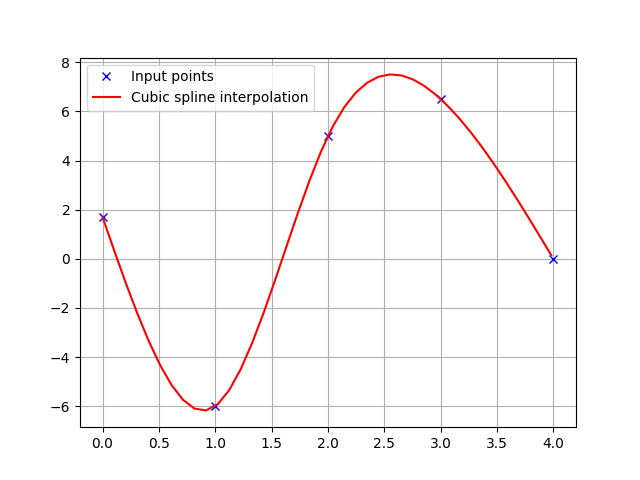

# 4.1 Course generation with cubic splines

Cubic spline course generation for path tracking explained, with its equations and a Python simulation. A path tracking controller needs a smooth course with a direction and a curvature at every point, but a person or a planner gives only a few points. This section joins the points with a **natural cubic spline**, and computes the yaw angle, the curvature and the target speed along the course that the controllers of this chapter follow. After this section, you can compute the coefficients of a spline and explain where the course's yaw and curvature come from.

## Problem and intuition

The course is given as a few points $(x_0, y_0), \dots, (x_n, y_n)$, for example the five points $(0, 0)$, $(10, 4)$, $(25, -12)$, $(40, 20)$ and $(50, -13)$ m used by the path tracking simulations. Straight lines between them would give a course with corners: the direction would jump at each point, and a vehicle can't turn on the spot. The controllers of this chapter also need the course's **yaw angle** $\theta_r$ and **curvature** $\kappa$, which a polyline doesn't have between its points.

A cubic spline joins each pair of neighboring points with a cubic polynomial, and chooses the polynomials so that the value, the slope and the second derivative don't jump where two pieces meet. The result looks like a bent flexible ruler laid through the points, which is where the name comes from. Each piece is a cubic, so its first and second derivatives are simple formulas, and the yaw angle and the curvature follow from them.



**Run it** from the repository root: `python src/simulations/course/cubic_spline/cubic_spline_plot.py` for the one-dimensional spline above, and `python src/simulations/course/cubic_spline/cubic_spline_2d_plot.py` for the course with its yaw angle and curvature ([code on GitHub](/src/simulations/course/cubic_spline))

## Theory

The symbols follow [Notation and Units](../NOTATION.md).

### A cubic spline of one variable

Let a quantity $q$ be given at the knots $s_0 < s_1 < \dots < s_n$ as the values $q_0, \dots, q_n$. Later $q$ is the $x$ or the $y$ coordinate of the course, and $s$ the distance along it. Between the knots $s_i$ and $s_{i+1}$, the spline is the cubic

$$
S_i(s) = a_i + b_i (s - s_i) + c_i (s - s_i)^2 + d_i (s - s_i)^3,
\qquad s_i \le s \le s_{i+1} \tag{1}
$$

for $i = 0, \dots, n - 1$, with the segment length $h_i = s_{i+1} - s_i$. The $n$ cubics have $4n$ coefficients. They are fixed by these conditions:

$$
S_i(s_i) = q_i, \quad
S_i(s_{i+1}) = q_{i+1}, \quad
S_{i-1}'(s_i) = S_i'(s_i), \quad
S_{i-1}''(s_i) = S_i''(s_i) \tag{2}
$$

The first two say that each piece goes through the points at its ends ($2n$ equations). The last two say that the slope and the second derivative don't jump at the inner knots $s_1, \dots, s_{n-1}$ ($2(n - 1)$ equations). That is $4n - 2$ equations for $4n$ unknowns, so two more conditions are needed at the ends; they come below.

**Solving for the coefficients.** The first condition gives $a_i = q_i$ directly. The derivatives of (1) are $S_i'(s) = b_i + 2c_i(s - s_i) + 3d_i(s - s_i)^2$ and $S_i''(s) = 2c_i + 6d_i(s - s_i)$. Write $c_n = S_{n-1}''(s_n) / 2$ for the end of the last piece, so that every knot has a $c_i$. Then:

- The second derivative doesn't jump at $s_{i+1}$: $2c_i + 6d_i h_i = 2c_{i+1}$, which gives $d_i$.
- The piece ends at $q_{i+1}$: $q_i + b_i h_i + c_i h_i^2 + d_i h_i^3 = q_{i+1}$. Putting in $d_i$ gives $b_i$.

$$
a_i = q_i, \qquad
d_i = \frac{c_{i+1} - c_i}{3h_i}, \qquad
b_i = \frac{q_{i+1} - q_i}{h_i} - \frac{h_i}{3}\left(2c_i + c_{i+1}\right) \tag{3}
$$

So all the coefficients follow from the $c_i$. The last condition, that the slope doesn't jump at $s_i$, is $b_{i-1} + 2c_{i-1}h_{i-1} + 3d_{i-1}h_{i-1}^2 = b_i$. Putting (3) into it leaves one linear equation in three neighboring $c$'s for each inner knot $i = 1, \dots, n - 1$:

$$
h_{i-1} c_{i-1} + 2\left(h_{i-1} + h_i\right) c_i + h_i c_{i+1}
= \frac{3}{h_i}\left(q_{i+1} - q_i\right) - \frac{3}{h_{i-1}}\left(q_i - q_{i-1}\right) \tag{4}
$$

**The ends.** A **natural** spline sets the second derivative to zero at both ends, so the course is straight there:

$$
c_0 = 0, \qquad c_n = 0 \tag{5}
$$

(4) and (5) are $n + 1$ linear equations for $c_0, \dots, c_n$. Each equation involves only three neighboring unknowns, so the matrix of the system is tridiagonal, and it always has a unique solution when the knots are distinct. With the $c_i$ known, (3) gives the other coefficients, and (1) gives the spline anywhere.

### A course in the plane

A course can turn back on itself in $x$ (the five points above go right, then left, then right again in $y$), so $y$ can't be written as a function of $x$. Instead, $x$ and $y$ are both written as functions of a parameter $s$, and each gets its own spline (1) to (5). The parameter is the **cumulative chord length**, the distance along the straight lines between the given points:

$$
s_0 = 0, \qquad
s_{i+1} = s_i + \sqrt{\left(x_{i+1} - x_i\right)^2 + \left(y_{i+1} - y_i\right)^2} \tag{6}
$$

The course is then $(x(s), y(s))$ with the two splines through $(s_i, x_i)$ and $(s_i, y_i)$. $s$ is close to the distance traveled along the course, but not equal to it: the spline between two points is a little longer than the chord.

**Yaw angle.** The direction of the course is the direction of its tangent $(x'(s), y'(s))$, where $'$ is the derivative with respect to $s$:

$$
\theta_r(s) = \operatorname{atan2}\left(y'(s), x'(s)\right) \tag{7}
$$

**Curvature.** The curvature is how fast the yaw angle turns per meter driven, $\kappa = d\theta_r / d\sigma$, where $\sigma$ is the true distance along the course. Differentiating (7) gives $d\theta_r / ds = (x'y'' - y'x'') / (x'^2 + y'^2)$, and the distance grows as $d\sigma / ds = \sqrt{x'^2 + y'^2}$. Dividing the two:

$$
\kappa(s) = \frac{x'(s)\,y''(s) - y'(s)\,x''(s)}{\left(x'(s)^2 + y'(s)^2\right)^{3/2}} \tag{8}
$$

$\kappa$ is positive where the course turns left (counterclockwise) and negative where it turns right, and $1 / |\kappa|$ is the radius of the circle that fits the course at that point. Because (8) divides by $d\sigma / ds$, it is the exact curvature even though $s$ is not exactly the distance traveled. With (1), $x''$ and $y''$ are continuous, so the curvature of a cubic spline course is continuous too: it changes gradually, without jumps, which matters for the controllers that use it (see the [rear wheel feedback section](rear_wheel_feedback.md)).

```{figure} figures/cubic_spline_course.svg
:alt: Top, the course through the five given points, drawn as a smooth curve with arrows showing its yaw angle at several places. Bottom, the curvature along the distance s: zero at both ends, a small negative dip, a positive peak of about 0.5 per meter, and a negative peak of about minus 1 per meter after the fourth point, where the course turns sharply right.

The course of the path tracking simulations, computed with (1) to (8). Top: the course and its yaw angle. Bottom: its curvature, which is zero at both ends because of the natural end conditions (5). The sharp right turn after the fourth point has $\kappa \approx -1$ 1/m, a radius of about 1 m.
```

### Points, yaw, curvature and speed along the course

The controllers don't evaluate the spline at every step. The course is sampled once, every 0.1 m of $s$, and each sample stores its position $(x_r, y_r)$, its yaw $\theta_r$ from (7), its curvature $\kappa$ from (8), and a target speed $v_r$. A controller searches the stored point it needs, for example the one nearest to the vehicle.

**Target speed.** The target speed is a constant given for the course (20 km/h in the path tracking simulations), with two changes:

- **Switch-backs.** If the yaw angle of two neighboring samples differs by between $\pi/4$ and $\pi/2$ rad, the course is taken to reverse direction there. The target speed is 0 at that sample, and its sign flips after it, so the vehicle drives that part backward.
- **Stopping at the end.** Over the last 100 samples (10 m), the target speed decreases linearly to 0, so the vehicle stops at the end of the course.

## Algorithm

```text
Given the points (x_0, y_0), ..., (x_n, y_n) and a target speed:
1. Compute the knots s_0, ..., s_n with (6)
2. For q = x and q = y:
   a. Set a_i = q_i
   b. Solve the linear equations (4) and (5) for c_0, ..., c_n
   c. Compute b_i and d_i with (3)
3. For s = 0, 0.1, 0.2, ... up to s_n:
   a. Find the segment i with s_i <= s < s_{i+1}
   b. Compute x, y and their first and second derivatives with (1)
   c. Compute the yaw angle with (7) and the curvature with (8)
4. Set the target speed of every sample, with 0 and a sign flip at the switch-backs
5. Ramp the target speed down to 0 over the last 100 samples
```

## Limits

- **The spline doesn't know the vehicle.** The spline only goes through the points; nothing limits its curvature. The course of the simulations has a turn of about 1 m radius after the fourth point (figure above), tighter than a real car can turn. Check $|\kappa|$ against $1 / R_{\min}$, the inverse of the vehicle's minimum turning radius, or move the points further apart.
- **The speed doesn't depend on the curvature.** The target speed is the same on the straight parts and in the 1 m turn, where a speed of 20 km/h (5.6 m/s) would mean a lateral acceleration $v^2 |\kappa| \approx 31$ m/s², about three times the 10 m/s² or so that tires hold on a dry road. The kinematic model of [Chapter 3](../vehicle_model/index.md) doesn't notice, but a real vehicle would slide. A common fix limits the speed to $\sqrt{a_{\text{lat},\max} / |\kappa|}$ for a maximum lateral acceleration $a_{\text{lat},\max}$.
- **Natural ends.** The natural end conditions (5) make the course straight at its start and end, and the start and end directions come out of the spline. A *clamped* spline, which fixes the slopes at both ends instead, can start the course in the vehicle's current direction.
- **Every point moves the whole course.** The $c_i$ come from one system of equations, so moving one point changes every segment a little, not only the two next to it. The effect fades quickly with the distance from the point.
- **Chord length is not distance.** $s$ from (6) is shorter than the distance along the curve, more so where the course bends sharply between two given points. The samples taken every 0.1 m of $s$ are therefore not exactly 0.1 m apart. The curvature (8) is exact anyway.
- **Distinct points.** Two neighboring given points must differ, otherwise $h_i = 0$ and (3) divides by zero.
- **Switch-back detection is a heuristic.** It only checks the change of yaw between two samples, so it depends on the sampling distance, and a sharp but forward turn could be taken for a reversal.

## References

1. R. L. Burden and J. D. Faires, "Numerical Analysis", 9th ed., Brooks/Cole, 2011. Chapter 3, cubic spline interpolation. The coefficients $a_i, b_i, c_i, d_i$ of (1) and the natural spline follow its notation.
