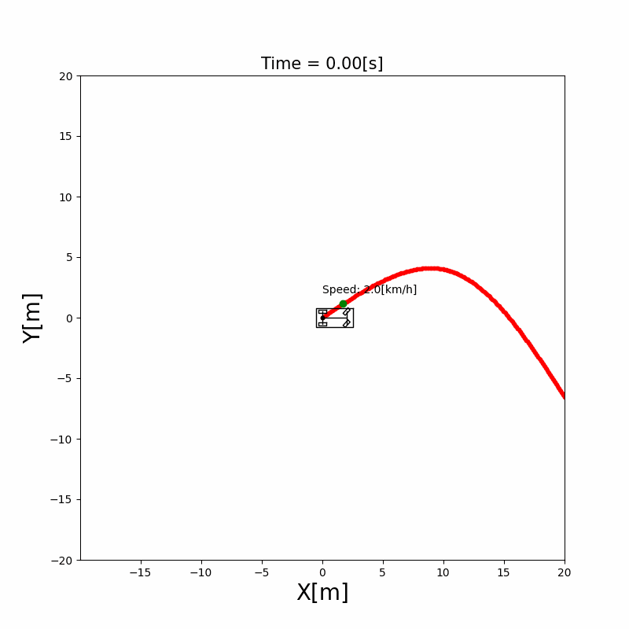

# 4.2 Pure Pursuit

The Pure Pursuit controller for path tracking explained, with its equations, the adaptive look-ahead distance and a Python simulation. Pure Pursuit steers a vehicle along a course by choosing a point on the course some distance ahead and driving the circular arc that reaches it. After this section, you can derive its steering angle from the geometry of the [kinematic bicycle model](../vehicle_model/index.md), and explain how the look-ahead distance changes the way the vehicle follows the course.

## Problem and intuition

A path tracking controller has to decide the steering angle at every time step so that the vehicle follows the course of [4.1](cubic_spline.md). Pure Pursuit does what a human driver does: look at a spot on the road some distance ahead, and steer toward it [1]. As the vehicle moves, the spot moves ahead along the course, so the vehicle keeps "pursuing" a point it never reaches.

The steering toward the point is pure geometry. There is exactly one circular arc that starts at the rear axle in the direction the vehicle is heading and passes through the point. The kinematic bicycle model says which steering angle drives a given circle, so the controller only has to find the arc and turn its radius into a steering angle.

The distance to the point, the **look-ahead distance**, is the controller's only parameter. A near point makes the vehicle steer sharply back to the course; a far point makes it steer gently and smoothly, but it starts turning before a curve begins. The **adaptive** version changes the look-ahead distance while driving: longer at high speed and on straight parts, shorter in sharp curves.



**Run it** from the repository root: `python src/simulations/path_tracking/pure_pursuit_path_tracking/pure_pursuit_path_tracking.py` ([code on GitHub](/src/simulations/path_tracking/pure_pursuit_path_tracking)), and the adaptive version with `python src/simulations/path_tracking/adaptive_pure_pursuit_path_tracking/adaptive_pure_pursuit_path_tracking.py` ([code on GitHub](/src/simulations/path_tracking/adaptive_pure_pursuit_path_tracking))

## Theory

The symbols follow [Notation and Units](../NOTATION.md). The vehicle's state $(x, y, \theta, v)$ is given at the rear axle.

### The look-ahead point and the arc through it

**Look-ahead point.** Let $(x_p, y_p)$ be the point on the course at the look-ahead distance $l_d$ from the rear axle, ahead of the vehicle. The angle $\alpha$ between the vehicle's heading and the line from the rear axle to that point is

$$
\alpha = \operatorname{atan2}\left(y_p - y, x_p - x\right) - \theta \tag{1}
$$

$\alpha$ is positive when the point is on the left of the heading.

```{figure} figures/pure_pursuit_geometry.svg
:alt: The vehicle with its rear axle at (x, y) and its heading theta. A straight line of length l_d goes from the rear axle to the look-ahead point on the course, at the angle alpha from the heading. A dashed circular arc starts at the rear axle along the heading and passes through the look-ahead point. Its center of rotation is at the distance R from both the rear axle and the look-ahead point. The front wheel is turned by the steering angle delta.

The geometry of Pure Pursuit. The arc starts at the rear axle along the heading and passes through the look-ahead point. The rear axle, the look-ahead point and the center of rotation form an isosceles triangle with two sides $R$.
```

**The arc.** The arc starts at the rear axle along the heading, so its center lies on the line through the rear axle perpendicular to the heading, at the distance $R$. The look-ahead point is on the arc, so it is at the distance $R$ from the center too. The rear axle, the look-ahead point and the center form an isosceles triangle with two sides $R$ and the base $l_d$ (the chord of the arc). The radius to the rear axle is perpendicular to the heading, so the angle between that radius and the chord is $\pi/2 - \alpha$, and the same angle is at the look-ahead point. The angle at the center is then $\pi - 2(\pi/2 - \alpha) = 2\alpha$. The law of sines in this triangle gives

$$
\frac{l_d}{\sin 2\alpha} = \frac{R}{\sin\left(\pi/2 - \alpha\right)}
\quad\Rightarrow\quad
\frac{l_d}{2\sin\alpha\cos\alpha} = \frac{R}{\cos\alpha}
\quad\Rightarrow\quad
R = \frac{l_d}{2\sin\alpha} \tag{2}
$$

and the curvature of the arc is

$$
\kappa = \frac{1}{R} = \frac{2\sin\alpha}{l_d} = \frac{2}{l_d^2}\, e_p,
\qquad e_p = l_d \sin\alpha \tag{3}
$$

$e_p$ is the lateral offset of the look-ahead point in the vehicle's frame: how far the point is to the left of the vehicle's heading. The last form of (3) shows that Pure Pursuit is a **proportional controller**: the curvature it drives is the lateral offset of a point ahead, multiplied by the gain $2 / l_d^2$ [1]. A shorter look-ahead distance means a higher gain.

### From the arc to the steering angle

In the kinematic bicycle model, a steering angle $\delta$ makes the rear axle drive a circle of radius $R = L / \tan\delta$ (equation (1) of [Chapter 3](../vehicle_model/index.md)), where $L$ is the wheelbase. Setting it equal to (2) and solving for $\delta$ gives the steering law of Pure Pursuit:

$$
\delta = \arctan\frac{2L\sin\alpha}{l_d} \tag{4}
$$

The vehicle model of this project takes a yaw rate as its input, so the steering angle is turned into a yaw rate with equation (3) of [Chapter 3](../vehicle_model/index.md):

$$
\omega = \frac{v\tan\delta}{L} = \frac{2v\sin\alpha}{l_d} = v\,\kappa \tag{5}
$$

The yaw rate is the speed times the curvature of the arc, as it must be for a vehicle driving that arc.

**Speed.** The speed follows the course's target speed $v_r$ at the look-ahead point with a proportional controller, $a = k_v (v_r - v)$.

### The look-ahead distance

**Growing with the speed.** The look-ahead distance grows with the speed:

$$
l_d = k\,v + l_{d,\min} \tag{6}
$$

with the gain $k$ in seconds and the minimum look-ahead distance $l_{d,\min}$, used when the vehicle stands still. The simulation `pure_pursuit_path_tracking` uses $k = 0.3$ s and $l_{d,\min} = 2$ m, so $l_d \approx 3.7$ m at the target speed of 20 km/h.

**Why grow with the speed.** Consider a straight course along the $x$ axis, and a vehicle with a small lateral error $e$ (positive to the left of the course) and a small heading error $\theta_e$. The look-ahead point is about $l_d$ ahead, and its lateral offset in the vehicle's frame is $e_p \approx -(e + l_d\,\theta_e)$. The vehicle moves sideways at $\dot e = v\sin\theta_e \approx v\,\theta_e$, and its heading turns at $\dot\theta_e = \omega = v\,\kappa$ with $\kappa$ from (3). Differentiating $\dot e$ once more:

$$
\ddot e + \frac{2v}{l_d}\,\dot e + \frac{2v^2}{l_d^2}\,e = 0 \tag{7}
$$

This is a damped oscillator with the natural frequency $\omega_n = \sqrt{2}\,v / l_d$ and the damping ratio $\zeta = 1/\sqrt{2} \approx 0.71$, whatever the speed and the look-ahead distance: the vehicle comes back to the course with a small overshoot (about 4 % from a pure offset), never with a weave. Written per meter driven instead of per second ($d/dt = v\,d/ds$), (7) becomes $e'' + (2/l_d)\,e' + (2/l_d^2)\,e = 0$, which doesn't contain the speed at all: with a fixed $l_d$, the vehicle comes back to the course over the same distance at any speed, about $2\,l_d$. At a higher speed it covers that distance in less time, with a larger yaw rate. Making $l_d$ grow with the speed, as (6) does, keeps the time to come back about the same, $l_d / v \approx k$ at high speed.

**Adaptive look-ahead distance.** The adaptive version also shortens the look-ahead distance in curves:

$$
l_d = \min\left(\max\left(\frac{k\,v + l_{d,\min}}{1 + k_\kappa |\kappa_n|},\; l_{d,\min}\right),\; l_{d,\max}\right) \tag{8}
$$

where $\kappa_n$ is the curvature (equation (8) of [4.1](cubic_spline.md)) of the course point nearest to the rear axle, $k_\kappa$ in meters sets how much the curvature shortens the look-ahead distance ($k_\kappa = 0$ gives back (6)), and $l_{d,\max}$ limits it from above. On a straight part $\kappa_n = 0$ and (8) is (6). In a curve the look-ahead point comes closer, so the arc follows the curve more tightly. The simulation `adaptive_pure_pursuit_path_tracking` uses $k = 0.4$ s, $k_\kappa = 2$ m, $l_{d,\min} = 2$ m and $l_{d,\max} = 25$ m: $l_d \approx 4.2$ m on the straight parts at 20 km/h, and it drops to the minimum of 2 m where $|\kappa_n| \ge 0.56$ 1/m.

The speed term of (6) is the usual choice [2]. The curvature factor of (8) is a heuristic of this implementation, not a law from the literature.

## Algorithm

```text
At every time step, given the state (x, y, theta, v) at the rear axle:
1. Compute the look-ahead distance l_d with (6), or with (8) for the adaptive version
2. Find the course point nearest to the rear axle, then walk forward along the course
   to the first point at least l_d away from the rear axle: the look-ahead point
3. Compute the angle alpha to the look-ahead point with (1)
4. Compute the steering angle with (4)
5. Compute the yaw rate with (5), and the acceleration from the target speed
   at the look-ahead point
```

In step 2, the point found is a little farther than $l_d$, by less than the 0.1 m between the course points, and (4) uses $l_d$, not the distance to that point. If the vehicle is more than $l_d$ away from the course, the nearest point itself is used.

## Limits

- **Tuning the look-ahead distance.** A short $l_d$ is a high gain $2 / l_d^2$ in (3): the vehicle comes back to the course quickly, but a delay in the real steering or noise in the position makes it weave. A long $l_d$ is smooth but slow to come back. (7) shows that the kinematic model alone never weaves; the oscillations of a real vehicle come from what the model leaves out.
- **Cutting corners.** A far look-ahead point is already in a curve while the vehicle is still on the straight part before it, so the vehicle starts turning early and cuts to the inside of the curve. On a circle of constant curvature, the kinematic model settles on the course itself: the error appears where the curvature changes, and it grows with $l_d$. This is why the adaptive version shortens $l_d$ in curves. It uses the curvature at the nearest point, so it only shortens $l_d$ once the vehicle is in the curve, not before.
- **Only one point.** Pure Pursuit doesn't use the course's heading or curvature at the vehicle, only where the look-ahead point is. Two vehicles with different headings but the same look-ahead point get the same steering.
- **Far from the course.** The arc assumes that the look-ahead point is ahead ($|\alpha| < \pi/2$) and $l_d$ away. When the vehicle is farther than $l_d$ from the course, the target point is farther than $l_d$, but (4) still uses $l_d$, so the vehicle steers harder than the geometry says. When the point is behind the vehicle, $\sin\alpha$ gets small again, and the vehicle turns too little.
- **Kinematic model only.** The steering law assumes that the wheels don't slip and that the steering acts at once. At high speed, tire slip and actuator delay make the vehicle drift off the arc, and the look-ahead distance has to be tuned for each speed.
- **Pure Pursuit vs Stanley.** Pure Pursuit looks at one point $l_d$ ahead of the rear axle. The [Stanley controller](stanley.md) looks at the course point nearest to the front axle and uses the heading error and the lateral error there; it doesn't look ahead. At speed, Stanley's steering toward the course shrinks as $k e / v$, so the front axle's offset decays at the rate $k$ per second at any speed, over a distance $v / k$ that grows with the speed [3]. Pure Pursuit with a fixed $l_d$ comes back over a fixed distance instead, and with (6) it behaves like Stanley at high speed. The [rear wheel feedback section](rear_wheel_feedback.md#pure-pursuit-vs-stanley-vs-rear-wheel-feedback) compares all three.

## References

1. R. C. Coulter, "Implementation of the Pure Pursuit Path Tracking Algorithm", Technical Report CMU-RI-TR-92-01, Carnegie Mellon University, 1992. [PDF](https://www.ri.cmu.edu/pub_files/pub3/coulter_r_craig_1992_1/coulter_r_craig_1992_1.pdf)
2. J. M. Snider, "Automatic Steering Methods for Autonomous Automobile Path Tracking", Technical Report CMU-RI-TR-09-08, Carnegie Mellon University, 2009. [PDF](https://www.ri.cmu.edu/pub_files/2009/2/Automatic_Steering_Methods_for_Autonomous_Automobile_Path_Tracking.pdf)
3. G. M. Hoffmann, C. J. Tomlin, M. Montemerlo and S. Thrun, "Autonomous Automobile Trajectory Tracking for Off-Road Driving: Controller Design, Experimental Validation and Racing", American Control Conference, 2007. [PDF](https://ai.stanford.edu/~gabeh/papers/hoffmann_stanley_control07.pdf)
