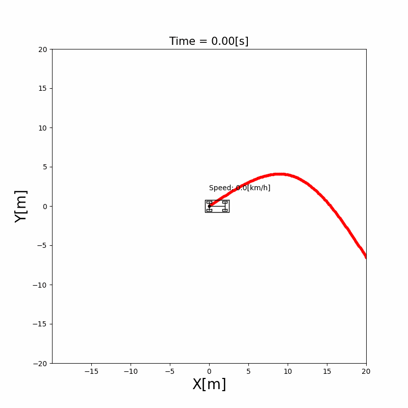

# 4.4 Rear wheel feedback

The rear wheel feedback controller for path tracking explained, with its equations, its Lyapunov stability argument and a Python simulation. Rear wheel feedback steers a vehicle along a course by looking at the lateral error and the heading error at the rear axle, and at the course's curvature there. After this section, you can derive its yaw rate law from the motion of the vehicle relative to the course, and compare it with Pure Pursuit and Stanley.

## Problem and intuition

Pure Pursuit ([4.2](pure_pursuit.md)) and Stanley ([4.3](stanley.md)) are geometric: they steer toward the course without knowing where it bends next. Rear wheel feedback adds that knowledge. Its yaw rate has two parts:

- **Follow the curve.** If the vehicle were exactly on the course, it would have to turn at the rate the course turns, $v\kappa$. This **feedforward** term comes from the course's curvature (equation (8) of [4.1](cubic_spline.md)), not from an error.
- **Correct the errors.** On top of it, the controller turns back by the heading error and toward the course by the lateral error, with two gains.

The errors are measured at the **rear axle**, the point whose motion the kinematic bicycle model describes most simply: it moves along the vehicle's heading and never sideways ([Chapter 3](../vehicle_model/index.md)). This makes it possible to write how the errors change in time exactly, and to choose the law so that the errors are guaranteed to shrink, with a Lyapunov function [1], [2].



**Run it** from the repository root: `python src/simulations/path_tracking/rear_wheel_feedback_tracking/rear_wheel_feedback_tracking.py` ([code on GitHub](/src/simulations/path_tracking/rear_wheel_feedback_tracking))

## Theory

The symbols follow [Notation and Units](../NOTATION.md). The vehicle's state $(x, y, \theta, v)$ is given at the rear axle.

### The errors at the rear axle

Let $(x_r, y_r)$ be the course point nearest to the rear axle, and $\theta_r$ and $\kappa$ the course's yaw and curvature there. The heading error $\theta_e$ and the lateral error $e$ are

$$
\theta_e = \theta - \theta_r, \qquad
e = -\sin\theta\,(x - x_r) + \cos\theta\,(y - y_r) \tag{1}
$$

These are the errors of the [Stanley controller](stanley.md), measured at the rear axle instead of the front axle. $e$ is positive when the rear axle is on the left of the course, $\theta_e$ when the vehicle points to the left of it.

```{figure} figures/rear_wheel_feedback_errors.svg
:alt: The vehicle with its rear axle at (x, y). The lateral error e is the distance from the nearest course point (x_r, y_r) to the rear axle, and the heading error theta_e is the angle between the course direction theta_r and the vehicle's heading theta, drawn at the rear axle.

The errors of rear wheel feedback, at the rear axle. Here the rear axle is on the left of the course and the vehicle points to the left of it, so both $e$ and $\theta_e$ are positive.
```

### How the errors change

Describe the rear axle's position by the distance $s$ along the course to its nearest point, and by the lateral error $e$. The rear axle moves with speed $v$ along the heading, which is turned by $\theta_e$ from the course, so it moves sideways at $v\sin\theta_e$ and along the course direction at $v\cos\theta_e$.

Along the course, the nearest point doesn't move at the same speed as the rear axle. The course turns around its center of curvature, at the distance $1/\kappa$ on the left of the course. The rear axle is $e$ to the left, so it is at the distance $1/\kappa - e$ from that center, and a motion of $v\cos\theta_e$ there moves the nearest point by a factor $(1/\kappa) / (1/\kappa - e) = 1 / (1 - \kappa e)$ more. The heading error changes as the vehicle turns, minus as the course turns under it. Together:

\begin{equation*}
\begin{aligned}
\dot s &= \frac{v\cos\theta_e}{1 - \kappa e} \\
\dot e &= v\sin\theta_e \\
\dot\theta_e &= \omega - \kappa\,\dot s = \omega - \frac{v\,\kappa\cos\theta_e}{1 - \kappa e}
\end{aligned} \tag{2}
\end{equation*}

where $\omega$ is the vehicle's yaw rate, the input of the vehicle model. These are the equations of motion in the course's frame, also called the Frenet frame [1].

### The control law

The yaw rate of rear wheel feedback is [1], [2]

$$
\omega = \frac{v\,\kappa\cos\theta_e}{1 - \kappa e}
- k_\theta |v|\,\theta_e
- k_e\,v\,\frac{\sin\theta_e}{\theta_e}\,e \tag{3}
$$

with the heading error gain $k_\theta > 0$ in 1/m and the lateral error gain $k_e > 0$ in 1/m².

- The **first term** is the feedforward: by (2), it is exactly the yaw rate that keeps $\theta_e$ constant. On the course with $e = \theta_e = 0$, it is $v\kappa$, the yaw rate of driving the course.
- The **second term** turns back by the heading error. It uses $|v|$, so it still turns back when the vehicle drives backward.
- The **third term** turns toward the course. For a small heading error, $\sin\theta_e / \theta_e \approx 1$ and the term is about $-k_e v e$. The factor $\sin\theta_e / \theta_e$ is there to make the Lyapunov argument below work; it tends to 1 as $\theta_e \to 0$.

### Why the errors shrink

Take the Lyapunov function, a measure of how far the vehicle is from the course that is zero only on the course:

$$
V = e^2 + \frac{\theta_e^2}{k_e} \tag{4}
$$

With (2) and (3), the first term of (3) cancels the course's turning in $\dot\theta_e$, which leaves $\dot\theta_e = -k_\theta|v|\theta_e - k_e v (\sin\theta_e/\theta_e)\,e$. Then

$$
\dot V = 2e\,\dot e + \frac{2\theta_e\,\dot\theta_e}{k_e}
= 2ev\sin\theta_e - \frac{2k_\theta|v|}{k_e}\,\theta_e^2 - 2ev\sin\theta_e
= -\frac{2k_\theta|v|}{k_e}\,\theta_e^2 \le 0 \tag{5}
$$

The third term of (3) was chosen so that the two $2ev\sin\theta_e$ terms cancel. $V$ never grows, so the errors stay bounded, and it decreases whenever $\theta_e \ne 0$. It can't get stuck with $\theta_e = 0$ and $e \ne 0$, because then $\dot\theta_e = -k_e v e \ne 0$ and the heading error grows again. So while the vehicle moves ($v \ne 0$) and stays close enough to the course for the nearest point to be well defined, both errors go to zero [1].

**Steering angle.** The vehicle model takes $\omega$ directly. The steering angle that drives it follows from equation (3) of [Chapter 3](../vehicle_model/index.md):

$$
\delta = \arctan\frac{L\,\omega}{v}, \qquad v \ne 0 \tag{6}
$$

and $\delta = 0$ when the vehicle stands still.

**Speed.** The speed follows the course's target speed $v_r$ at the nearest point with a proportional controller, $a = k_v (v_r - v)$.

### Behavior near the course

For small errors on a straight course ($\kappa = 0$) and $v > 0$, (2) and (3) become $\dot e \approx v\theta_e$ and $\dot\theta_e \approx -k_\theta v\,\theta_e - k_e v\,e$. Written per meter driven ($d/dt = v\,d/ds$):

$$
e'' + k_\theta\,e' + k_e\,e = 0 \tag{7}
$$

The speed has dropped out: the vehicle comes back to the course over the same distance at any speed, and with the natural frequency $\sqrt{k_e}$ per meter and the damping ratio $\zeta = k_\theta / (2\sqrt{k_e})$. The simulation uses $k_\theta = 1$ 1/m and $k_e = 0.5$ 1/m², so $\zeta \approx 0.71$.

(7) is the same equation as (7) of [4.2](pure_pursuit.md) written per meter, with $k_\theta = 2/l_d$ and $k_e = 2/l_d^2$. Near a straight course, rear wheel feedback behaves like Pure Pursuit with a fixed look-ahead distance; the gains of the simulation match $l_d = 2$ m. What rear wheel feedback adds is the feedforward term, which makes it follow a curve without waiting for an error to build up.

## Algorithm

```text
At every time step, given the state (x, y, theta, v) at the rear axle:
1. Find the course point nearest to the rear axle, and its yaw, curvature and target speed
2. Compute the heading error and the lateral error with (1)
3. Compute the yaw rate with (3)
4. Compute the steering angle with (6), using 0 when v = 0
5. Compute the acceleration from the target speed
```

## Pure Pursuit vs Stanley vs rear wheel feedback

| | Pure Pursuit ([4.2](pure_pursuit.md)) | Stanley ([4.3](stanley.md)) | Rear wheel feedback (4.4) |
|---|---|---|---|
| Point on the vehicle | Rear axle | Front axle | Rear axle |
| Point on the course | One point $l_d$ ahead | Nearest to the front axle | Nearest to the rear axle |
| What it uses | The direction to the look-ahead point, $\alpha$ | Heading error $\theta_e$, lateral error $e$ | $\theta_e$, $e$ and the curvature $\kappa$ |
| Looks ahead | Yes, by $l_d$ | No | No, but knows how the course bends where the vehicle is |
| Output | Steering angle $\delta$ | Steering angle $\delta$ | Yaw rate $\omega$ |
| Parameters | $l_d$, or $k$ and $l_{d,\min}$ | $k$ | $k_\theta$, $k_e$ |
| Coming back to the course | Over about $2\,l_d$: a fixed distance with a fixed $l_d$, a fixed time with $l_d \propto v$ | At the rate $k$ per second: over a distance that grows with $v$ | Over a fixed distance, set by $k_\theta$ and $k_e$ |
| At high speed | Needs a longer $l_d$, otherwise it corrects too fast | Its correction $k e / v$ softens by itself | Corrects as fast per meter as at low speed, so the gains must be lowered |
| Needs from the course | Positions only | Positions and yaw | Positions, yaw and a smooth curvature |

All three use the kinematic bicycle model, so all three lose accuracy when the tires slip at high speed. [Chapter 10](../optimal_control/index.md) replaces them with controllers that optimize over a horizon.

## Limits

- **Far from the course.** (2) and (3) divide by $1 - \kappa e$, which is zero when the rear axle is at the course's center of curvature, $e = 1/\kappa$. The law is meant for a vehicle near the course; far from it, the nearest point can also jump from one part of the course to another [1].
- **A smooth curvature.** The curvature goes straight into the yaw rate through the feedforward term, so the course needs a continuous curvature. The cubic spline of [4.1](cubic_spline.md) has one; a polyline or a course with noisy curvature would make the steering jump.
- **Speed and gains.** By (7), the vehicle corrects an error over the same distance at any speed, so at high speed it corrects in less time, with large yaw rates. $k_\theta$ and $k_e$ have to be lowered for fast driving, or scaled with the speed. At low speed, (6) turns even a small $\omega$ into a large steering angle, and the code doesn't limit it.
- **Zero heading error in the code.** The implementation sets the whole yaw rate to 0 when $\theta_e$ is exactly 0, to avoid dividing by zero in $\sin\theta_e / \theta_e$. This also drops the feedforward and the lateral error terms at that step. The limit of $\sin\theta_e / \theta_e$ is 1, which could be used there instead. A float is rarely exactly 0, so the effect is small.
- **Lateral error in the vehicle's frame.** (1) measures the offset along the vehicle's left direction, as for Stanley, while (2) uses the distance perpendicular to the course. The two agree when the heading error is small.
- **Sign convention of the reference.** [1] gives the same law (3) and the same equations (2); its figure draws $e$ with the opposite sign. The signs of this page follow [Notation and Units](../NOTATION.md).
- **Kinematic model only.** The law ignores tire slip and actuator delay, like the other controllers of this chapter.

## References

1. B. Paden, M. Čáp, S. Z. Yong, D. Yershov and E. Frazzoli, "A Survey of Motion Planning and Control Techniques for Self-Driving Urban Vehicles", IEEE Transactions on Intelligent Vehicles, vol. 1, no. 1, pp. 33–55, 2016. Section V-A2. [DOI](https://doi.org/10.1109/TIV.2016.2578706), [arXiv](https://arxiv.org/abs/1604.07446)
2. C. Samson, "Path following and time-varying feedback stabilization of a wheeled mobile robot", International Conference on Automation, Robotics and Computer Vision, 1992. The original of the law, as cited by [1].
