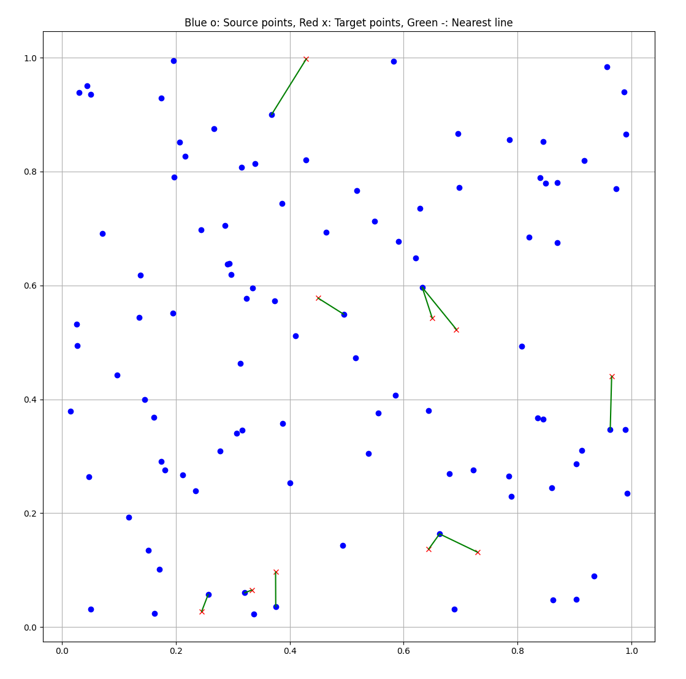

# 9.1 Nearest neighbor search with a kd-tree

Nearest neighbor search with a kd-tree (k-d tree) explained, with its equations and a Python simulation. A kd-tree sorts the points of a LiDAR point cloud into a binary tree, so that the point nearest to a query point, or all points within a radius of it, can be found without measuring the distance to every point. After this section, you can build a kd-tree by hand, and say which parts of it a search can skip and why the result is still right.

## Problem and intuition

A LiDAR scan is a list of points with no order that helps a search. Finding the objects in it starts with one question, asked again and again: which points are near this one? Rectangle fitting (section 9.2) asks it for point after point of the scan, to group neighboring points into clusters.

The direct way is to measure the distance from the query point to every point and keep the smallest. That is $n$ distances for a cloud of $n$ points, and $n^2$ when every point of the cloud is a query.

A kd-tree [1] avoids most of these distances by sorting the points in space first:

- **Build.** Split the points into two halves with a line through the median point, then split each half with a line in the other direction, and so on. Every point becomes a node of a binary tree, and every node stands for a rectangular cell of the plane.
- **Search.** Walk down the tree to the cell that contains the query point, which gives a first candidate. Then walk back up. At each node, the other half only needs a visit if its cell reaches closer to the query point than the best point found so far. Most of the tree fails this test and is never looked at.



**Run it** from the repository root: `python src/simulations/perception/point_cloud_search/search_nearest_neighbor_kd_tree.py` for the nearest point, and `python src/simulations/perception/point_cloud_search/search_neighbor_points_kd_tree.py` for the points within a radius ([code on GitHub](/src/simulations/perception/point_cloud_search))

## Theory

The symbols follow [Notation and Units](../NOTATION.md). The source points are $\mathbf{p}_1, \dots, \mathbf{p}_n$, each with $k$ coordinates in m; a 2D LiDAR gives $k = 2$, which the figures use. The query point is $\mathbf{q}$ (the "target point" of the code). $p_j$ and $q_j$ are the coordinates of $\mathbf{p}$ and $\mathbf{q}$ on axis $j$, counted from 0: $j = 0$ is $x$ and $j = 1$ is $y$.

### The two searches

The **nearest neighbor search** finds the source point with the smallest distance to the query point:

$$
i^\ast = \arg\min_{i} \lVert \mathbf{p}_i - \mathbf{q} \rVert \tag{1}
$$

The **radius search** finds every source point within the search radius $r_s$ in m:

$$
\{\, i : \lVert \mathbf{p}_i - \mathbf{q} \rVert \le r_s \,\} \tag{2}
$$

Both use the Euclidean distance $\lVert \cdot \rVert$.

### Building the tree

A node at depth $\ell$ of the tree (the root has $\ell = 0$) splits its points on the axis

$$
j = \ell \bmod k \tag{3}
$$

so in 2D the root splits on $x$, its children on $y$, their children on $x$ again. The node sorts its points by the coordinate on axis $j$ and keeps the median point $\mathbf{s}$ for itself. The points before the median go to its left child and the points after it to its right child, and each child is built in the same way one level deeper. So for every point $\mathbf{p}$ under a node with the point $\mathbf{s}$:

$$
p_j \le s_j \ \text{in the left subtree}, \qquad p_j \ge s_j \ \text{in the right subtree} \tag{4}
$$

The line $x_j = s_j$ through the node's point is its **splitting line** (a plane in 3D). It cuts the node's cell into the cells of its two children.

```{figure} figures/kd_tree_build.svg
:alt: Left, seven points in the plane. A vertical line through p4 splits the plane in two, a horizontal line through p1 splits the left half, a horizontal line through p7 splits the right half, and vertical lines through the last four points split their cells. Right, the same tree. p4 is the root, its children are p1 and p7, the children of p1 are p3 and p2, and the children of p7 are p6 and p5.

A kd-tree of seven points. The root $\mathbf{p}_4$ is the median in $x$ and splits the plane with a vertical line. Its children $\mathbf{p}_1$ and $\mathbf{p}_7$ are the medians in $y$ of their halves and split them with horizontal lines. The left child holds the smaller coordinate.
```

Taking the median halves the number of points at every level, so the tree is balanced and has

$$
\lfloor \log_2 n \rfloor + 1 \tag{5}
$$

levels: 3 levels for the 7 points of the figure, and 7 levels for the 100 source points of the simulation.

### Which subtrees a search can skip

Take a node with the point $\mathbf{s}$ and the axis $j$, and say the query point is on its left, $q_j \le s_j$. The left subtree is the **near side**, and the right subtree the **far side**. By (4), every point $\mathbf{p}$ of the far side has $p_j \ge s_j \ge q_j$, and a distance is never shorter than its part along one axis:

$$
\lVert \mathbf{p} - \mathbf{q} \rVert \ \ge\ |p_j - q_j| \ \ge\ |s_j - q_j| \tag{6}
$$

No point of the far side is closer to the query point than the splitting line is. The same holds with left and right exchanged when $q_j > s_j$.

Let $d_{\min}$ be the distance to the nearest point found so far. A point of the far side can only be nearer if

$$
|q_j - s_j| < d_{\min} \tag{7}
$$

When (7) is false, the whole far side is skipped: by (6), all of its points are at least $d_{\min}$ away. Seen in the plane, (7) asks whether the circle of radius $d_{\min}$ around the query point crosses the splitting line.

```{figure} figures/kd_tree_pruning.svg
:alt: The seven points with the query point q at x 6.5 and y 3. A dashed circle around q passes through its nearest point p6. The circle doesn't reach the vertical splitting line through p4 or the horizontal splitting line through p7, so the left half of the plane and the cell above p7 are shaded as skipped. Only p4, p7 and p6 are visited.

A nearest neighbor search in the tree of the figure above, for $\mathbf{q} = (6.5, 3)$ m. The search walks down $\mathbf{p}_4$, $\mathbf{p}_7$, $\mathbf{p}_6$ and finds $d_{\min} = 1.12$ m at $\mathbf{p}_6$. On the way back, the splitting line of $\mathbf{p}_7$ is 2 m away and the one of $\mathbf{p}_4$ is 1.5 m away. Both are farther than $d_{\min}$, so the shaded cells are skipped. Three of the seven nodes are visited (filled).
```

For the radius search, the radius is fixed, and a subtree can hold a point of (2) only if its side of the splitting line is within $r_s$ of the query point:

$$
\text{visit the left subtree if } q_j - r_s \le s_j, \qquad \text{visit the right subtree if } q_j + r_s \ge s_j \tag{8}
$$

The near side always passes its test, and the far side passes when $|q_j - s_j| \le r_s$, which is (7) with $r_s$ in place of $d_{\min}$ and $\le$ in place of $<$, so that a point exactly at the radius is found.

### How much is skipped

When the points are spread evenly, the expected time of a nearest neighbor search grows like $\log n$ instead of $n$ [2].

The radius search can't do as well: it has to visit at least the points it returns, so its cost grows with the number of points inside the radius.

## Algorithm

```text
Build(points, depth):
1. If there are no points, return an empty tree
2. Choose the axis with (3) and sort the points by their coordinate on it
3. Make a node with the median point and the axis
4. Build the left child from the points before the median, at depth + 1
5. Build the right child from the points after the median, at depth + 1

Nearest(node, q), starting at the root with d_min = infinity:
1. If the node is empty, return
2. If the distance from q to the node's point is shorter than d_min,
   keep the point as the nearest and the distance as d_min
3. Call Nearest on the near side: the left child if q_j <= s_j,
   and the right child otherwise
4. If (7) holds with the d_min of now, call Nearest on the far side

Within(node, q, r_s), starting at the root:
1. If the node is empty, return
2. If the distance from q to the node's point is r_s or less,
   add the point to the result
3. Call Within on the left child if q_j - r_s <= s_j
4. Call Within on the right child if q_j + r_s >= s_j
```

In step 3 of Nearest, the near side goes first because it is where a close point is most likely, and a small $d_{\min}$ makes (7) skip more in step 4.

## Limits

- **The code visits every node.** The current `KdTree` builds the tree as in this section, but its searches walk the whole tree instead of skipping subtrees ([#281](https://github.com/ShisatoYano/AutonomousVehicleControlBeginnersGuide/issues/281)). The results are right, but every search costs $n$ visits. This note is removed when #281 is fixed.
- **The worst case is still $n$.** (7) skips nothing when many points are at about the same distance from the query point, for example points on a circle with the query point at its center: every splitting line then crosses the circle of radius $d_{\min}$.
- **Many dimensions.** (6) uses one coordinate. With many coordinates, the difference on one axis is a small part of the distance, (7) is true at most nodes and the search comes close to comparing every point. In 2D and 3D, the dimensions of LiDAR points, this isn't a problem.
- **A fixed set of points.** The tree is balanced because every node takes the median of the points it is built from. A point added later would go below a leaf and make the tree deeper on one side, so a new tree is built for every scan.
- **Sorting at every level.** Sorting the points at each of the $\log_2 n$ levels costs about $n (\log_2 n)^2$ steps in total. Finding the median without a full sort would bring this down to about $n \log_2 n$, but sorting is easier to read.

## Check your understanding

1. In the second figure, the search for $\mathbf{q} = (6.5, 3)$ m skips the left half of the plane. Does it also skip it for $\mathbf{q} = (5.5, 3)$ m, and which point is the nearest then?

   <details><summary>Answer</summary>

   No. The search measures the root $\mathbf{p}_4 = (5, 4)$ first, at 1.12 m, and no point on the walk down to $\mathbf{p}_6$ (1.80 m) is closer, so $d_{\min} = 1.12$ m. Back at the root, the splitting line is $|5.5 - 5| = 0.5$ m away, so (7) holds and the left half has to be visited. It holds no closer point, and the nearest point is the root $\mathbf{p}_4$: the cell that contains the query point doesn't have to contain its nearest point.

   </details>

2. Why is the result of the nearest neighbor search still right when a whole subtree is skipped without measuring any distance in it?

   <details><summary>Answer</summary>

   By (6), every point of the far side is at least as far from the query point as the splitting line, $|q_j - s_j|$. The subtree is only skipped when (7) is false, that is $|q_j - s_j| \ge d_{\min}$. Then all its points are at least $d_{\min}$ away, and none of them can replace the nearest point found so far.

   </details>

3. Nearest always visits the near side and tests only the far side with (7). The result would be the same if the far side were tested first and the near side visited after it. Why does the algorithm visit the near side first?

   <details><summary>Answer</summary>

   Because of the cost, not the result. A close point is most likely on the near side, so visiting it first makes $d_{\min}$ small before the far side is tested, and (7) then fails for more far sides. Tested first, the far side would meet a large $d_{\min}$, or none at all, and would be visited almost every time.

   </details>

```{note}
This section has its theory. The code walkthrough, experiments and exercises are added after the code roadmap's Phase 1 ([#131](https://github.com/ShisatoYano/AutonomousVehicleControlBeginnersGuide/issues/131)), when the interfaces they show are stable.
```

## References

1. J. L. Bentley, "Multidimensional Binary Search Trees Used for Associative Searching", Communications of the ACM, vol. 18, no. 9, pp. 509–517, 1975. The paper that introduced the kd-tree. [DOI](https://doi.org/10.1145/361002.361007)
2. J. H. Friedman, J. L. Bentley and R. A. Finkel, "An Algorithm for Finding Best Matches in Logarithmic Expected Time", ACM Transactions on Mathematical Software, vol. 3, no. 3, pp. 209–226, 1977. Nearest neighbor search in a kd-tree, and its expected search time. [DOI](https://doi.org/10.1145/355744.355745)
