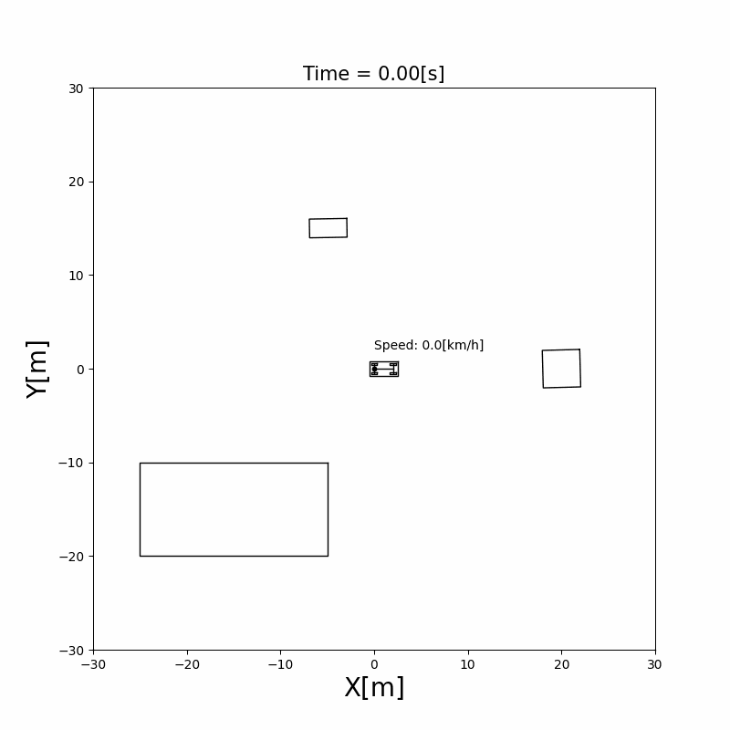
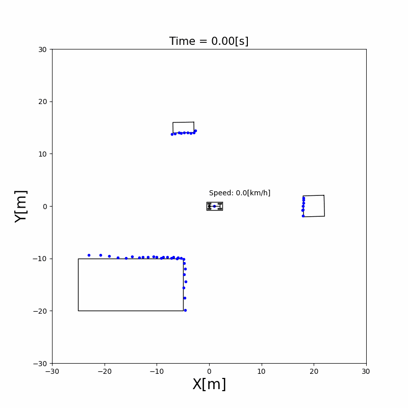

# Chapter 5: Sensing the World

LiDAR and GNSS sensor models for autonomous driving in Python: point clouds with occlusion and noise, noisy positions, and calibration of the sensor's mounting position. A vehicle that only follows its commands doesn't know where it is or what is around it. This chapter adds the sensors: obstacles to be sensed, a LiDAR that measures their outlines as a point cloud, and a GNSS receiver that measures the vehicle's position with noise. Each sensor is a model, **what it would measure if the world were as the simulator says, plus noise**. The later chapters estimate the vehicle's pose (Chapter 6), build maps (Chapter 7) and find objects (Chapter 9) from these measurements.

## 5.1 Obstacles

An obstacle is a rectangle with a pose $(x, y, \theta)$ in the global frame. It moves with the same motion model as the vehicle ([Chapter 3](../vehicle_model/index.md)), with a constant acceleration and yaw rate: when both are zero, it stands still.

Its four corners are fixed in its own frame, at $(\pm l, \pm w)$, where $l$ and $w$ are half of its length and half of its width (`length_m` and `width_m` in the code). At every step, the corners are moved into the global frame with the obstacle's pose, as in [Notation and Units](../NOTATION.md#frames):

$$
{}^{G}\mathbf{p} = \mathrm{Rot}(\theta)\, {}^{O}\mathbf{p} + [x, y]^\top \tag{1}
$$

The example below puts one static and two moving obstacles in the world with a vehicle:

```{literalinclude} visualize_obstacle.py
:language: python
:pyobject: main
```



Run it from the repository root with `python doc/sensors/visualize_obstacle.py`.

## 5.2 LiDAR and point clouds

**What a LiDAR measures.** A LiDAR sends laser beams in many directions and measures how far each beam travels before it hits something. A 2D LiDAR turns in one plane, so each return is a **range** $r$ and a **bearing** $\phi$ in the sensor frame $\{S\}$. A point ${}^{S}\mathbf{p} = [p_x, p_y]^\top$ on an obstacle is seen at

$$
r = \sqrt{p_x^2 + p_y^2}, \qquad \phi = \operatorname{atan2}(p_y, p_x) \tag{2}
$$

**One return per beam.** The beams are $\Delta\phi$ apart (2° by default), and each beam returns only the **nearest** point in its direction: what is behind it is hidden. The simulator samples points along the outline of every obstacle, computes $(r, \phi)$ of each with (2), and keeps the smallest $r$ in each beam $k = \operatorname{round}(\phi / \Delta\phi)$. A beam returns nothing if its range is outside $[r_{\min}, r_{\max}]$ (0.5 m to 40 m by default).

```{figure} figures/lidar_scan.svg
:alt: A sensor at the origin of its frame and three rectangular obstacles. Beams go out every few degrees and end at the nearest point of an obstacle. The lower part of a far obstacle has no points, because a nearer obstacle is in front of it. One beam is labeled with its range r and bearing phi, and a dashed arc shows the maximum range.

A simulated scan, with beams every 4° so they can be seen. Each beam keeps only its nearest point, so the far obstacle is seen only where the near one doesn't hide it.
```

**Noise.** A real LiDAR measures a little differently each time. The simulator adds Gaussian noise to the bearing of the beam and to the range:

$$
\tilde{\phi} = k\,\Delta\phi + n_\phi, \quad n_\phi \sim \mathcal{N}(0, \sigma_\phi^2), \qquad
\tilde{r} = r + n_r, \quad n_r \sim \mathcal{N}\!\left(0, (c_r\, r)^2\right) \tag{3}
$$

The standard deviation of the range noise grows with the range: by default $\sigma_\phi = 0.01$ rad and $c_r = 0.005$, so a point 20 m away has a range error of about 0.1 m. In the code these are `angle_std_scale` and `dist_std_rate` of `SensorParameters`.

**From the sensor to the world.** A return is a point ${}^{S}\mathbf{p} = \tilde{r}\,[\cos\tilde{\phi}, \sin\tilde{\phi}]^\top$ in the sensor frame. The sensor is mounted on the vehicle at $(l_x, l_y)$ with a yaw $\theta_s$ in the vehicle frame, so the point is moved twice, first into the vehicle frame and then into the global frame:

$$
{}^{G}\mathbf{p} = \mathrm{Rot}(\theta)\left(\mathrm{Rot}(\theta_s)\, {}^{S}\mathbf{p} + [l_x, l_y]^\top\right) + [x, y]^\top \tag{4}
$$

Chained moves like this are easier with **homogeneous transformation matrices**, which put the rotation and the translation into one $3 \times 3$ matrix:

$$
T(x, y, \theta) =
\begin{bmatrix}
\mathrm{Rot}(\theta) & [x, y]^\top \\
\mathbf{0}^\top & 1
\end{bmatrix},
\qquad
\begin{bmatrix} {}^{G}\mathbf{p} \\ 1 \end{bmatrix}
= {}^{G}T_{V}\, {}^{V}T_{S}
\begin{bmatrix} {}^{S}\mathbf{p} \\ 1 \end{bmatrix}
$$

where ${}^{G}T_{V} = T(x, y, \theta)$ is the vehicle's pose and ${}^{V}T_{S} = T(l_x, l_y, \theta_s)$ is the sensor's mounting pose. A third frame only adds one more matrix to the product. The code builds these matrices with `hom_mat_33()` in `src/components/common/matrix_lib.py`.

The set of returns of one scan is a **point cloud**. The simulation [`lidar_obstacle_sensing`](/src/simulations/perception/lidar_obstacle_sensing) mounts a LiDAR at the middle of the vehicle and senses moving obstacles:



## 5.3 GNSS

A GNSS receiver (GPS and similar systems) measures the vehicle's position in the global frame. It measures neither the yaw nor the speed. The observation model picks the position out of the state and adds noise:

\begin{equation*}
\mathbf{z}_t = H \mathbf{x}_t + \mathbf{n}_t, \qquad
H = \begin{bmatrix} 1 & 0 & 0 & 0 \\ 0 & 1 & 0 & 0 \end{bmatrix}, \qquad
\mathbf{n}_t \sim \mathcal{N}(\mathbf{0}, R), \quad R = \begin{bmatrix} \sigma_x^2 & 0 \\ 0 & \sigma_y^2 \end{bmatrix} \tag{5}
\end{equation*}

$R$ is the covariance of the observation noise of [Notation and Units](../NOTATION.md#estimation). The localization simulations use $\sigma_x = \sigma_y = 1$ m: about two thirds of the observations fall within 1 m of the true position, and almost all within 2 m.

```{figure} figures/gnss_noise.svg
:alt: A vehicle's true path along a gentle curve, and GNSS observations scattered around it. Two shaded circles of radius sigma and two sigma are drawn around one true position.

Observations of equation (5) with $\sigma_x = \sigma_y = 1$ m around the true path. The shaded circles have radii $\sigma$ and $2\sigma$.
```

A single observation can be meters off, and it says nothing about the heading. [Chapter 6](../localization/index.md) combines the observations with the motion model to estimate the full pose, and uses $R$ to decide how much to trust each observation.

## 5.4 Estimating the sensor's mounting position

Equation (4) needs the mounting pose $(l_x, l_y, \theta_s)$. On a real vehicle it is measured by hand, with errors, and can shift over time. It can also be **estimated while driving**, by comparing how the sensor moves with how the vehicle moves.

Let $\Delta T_V = ({}^{G}T_{V,t-1})^{-1}\, {}^{G}T_{V,t}$ be the vehicle's motion during one step, written in its own frame at $t-1$, and $\Delta T_S$ the sensor's motion in the same way. Because the sensor's pose is ${}^{G}T_{S} = {}^{G}T_{V}\, {}^{V}T_{S}$ with a fixed ${}^{V}T_{S}$,

$$
\Delta T_S = \left({}^{V}T_{S}\right)^{-1} \Delta T_V\, {}^{V}T_{S} \tag{6}
$$

On a real vehicle, the vehicle's motion comes from its odometry, and the sensor's motion from its own measurements (for a LiDAR, by matching consecutive scans). The simulation computes both from the true poses. Equation (6) is then an observation model with the unknown ${}^{V}T_{S}$: the estimator treats $[l_x, l_y, \theta_s]^\top$ as a state that doesn't change, predicts $\Delta T_S$ from $\Delta T_V$ with (6), and corrects the state with the difference to the measured $\Delta T_S$. The simulation [`sensor_auto_calibration`](/src/simulations/perception/sensor_auto_calibration) does this with an unscented Kalman filter, explained in [Chapter 6](../localization/index.md).

**The vehicle has to turn.** Write $\Delta T_V$ as a rotation $\Delta\theta$ and a translation $\mathbf{d}$. With (6), the sensor moves by

$$
\mathrm{Rot}(-\theta_s)\left(\left(\mathrm{Rot}(\Delta\theta) - I\right) [l_x, l_y]^\top + \mathbf{d}\right)
$$

On a straight line, $\Delta\theta = 0$ and the mounting position $(l_x, l_y)$ drops out: every mounting position moves the sensor the same way. Only turns make the position observable, so the estimate improves in the curves of the course.


## The sensors in the system

The vehicle updates its sensors first in every step, before the detector, the mapper, the controller and the localizer, so all of them use the measurements of the same step ([Chapter 2](../simulator/index.md#22-time-and-the-simulation-loop) explains why the order matters). The `Sensors` class in `src/components/sensors/sensors.py` holds the LiDAR and the GNSS and passes them the vehicle's state.

The sensors' code will change with the code roadmap ([#131](https://github.com/ShisatoYano/AutonomousVehicleControlBeginnersGuide/issues/131)). Its walkthrough is added to this chapter after that change.

## Limits

- **A flat world.** The LiDAR scans one plane, and every obstacle is a rectangle that the plane cuts. Real LiDARs scan many planes and see the ground, curbs and overhanging objects.
- **Every beam that hits returns.** Real returns depend on the surface: dark, shiny or glass surfaces, rain and fog can lose or scatter them.
- **An instant scan.** A real LiDAR turns while the vehicle moves, so one scan is taken from slightly different poses (motion distortion). The model measures everything at one instant.
- **Independent noise.** The noise of (3) and (5) is drawn anew at every step. Real GNSS errors change slowly and can jump, for example when signals reflect off buildings (multipath), so neighboring observations have similar errors.
- **No delay.** Every measurement arrives in the step it is taken, with no latency.

## References

1. S. Thrun, W. Burgard and D. Fox, "Probabilistic Robotics", MIT Press, 2005. Chapter 6, measurement models of range finders.
2. R. Y. Tsai and R. K. Lenz, "A New Technique for Fully Autonomous and Efficient 3D Robotics Hand/Eye Calibration", IEEE Transactions on Robotics and Automation, 5(3), 1989. The calibration problem of equation (6), $AX = XB$.
3. P. D. Groves, "Principles of GNSS, Inertial, and Multisensor Integrated Navigation Systems", 2nd ed., Artech House, 2013. GNSS error sources.
