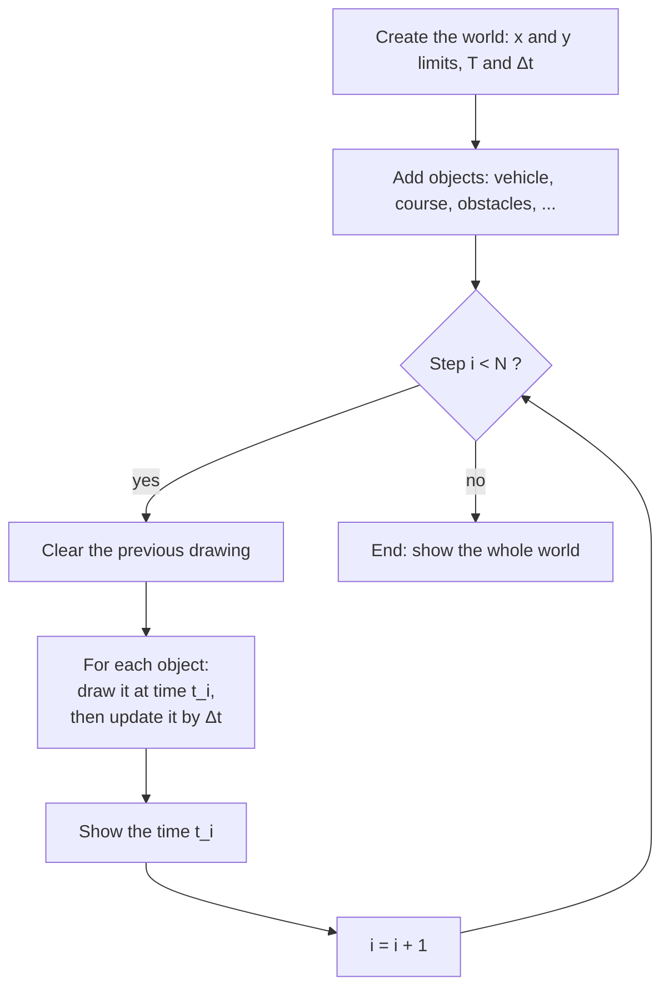
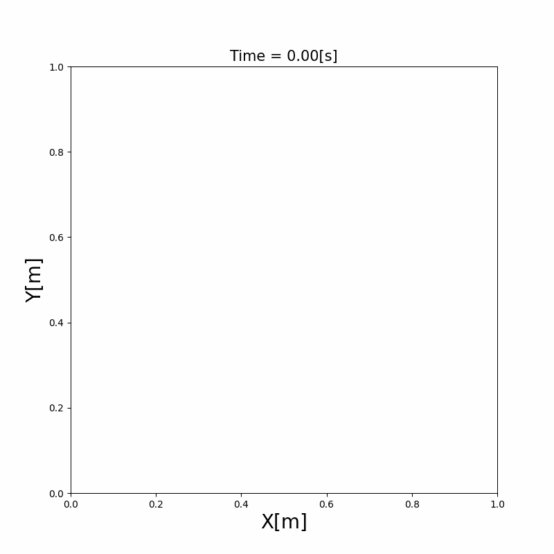

# Chapter 2: The Simulator: Frames, Units and the Loop

Every simulation in this book runs in the same small simulator: a 2D world in which objects (a vehicle, obstacles, a course, sensors, ...) are updated and drawn at regular time steps. This chapter explains the coordinate frames and units of that world, and how the simulator moves time forward. After it, you can create an empty world and know where every later chapter's objects plug in.

## 2.1 Frames and units

**The global frame.** The world has one fixed frame, the global frame $\{G\}$. Its x axis points to the right and its y axis up in the plots, and angles are measured counterclockwise from the x axis. Positions of every object, and the plots, are in this frame.

**The vehicle frame.** The vehicle carries its own frame $\{V\}$, with its origin at the center of the rear axle, its x axis pointing forward and its y axis to the left. The vehicle's pose in the global frame is its position $(x, y)$ and its yaw angle $\theta$.

```{figure} figures/frames.svg
:alt: The global frame with x to the right and y up. The vehicle sits at position (x, y), and its own frame has x_V pointing forward and y_V to the left, rotated by the yaw angle theta from the global x axis.

The global frame $\{G\}$ and the vehicle frame $\{V\}$. The vehicle's pose is $(x, y, \theta)$.
```

Sensors have a third kind of frame, introduced in [Chapter 5](../sensors/index.md). How to move a point from one frame to another is in [Notation and Units](../NOTATION.md#frames).

**Units.** Everything is in SI units: meters, seconds, radians, m/s and m/s². The code puts the unit in each variable name (`x_m`, `yaw_rad`, `speed_mps`), so you can check the units of an equation from the code. The full list is in [Notation and Units](../NOTATION.md#units-in-the-code).

## 2.2 Time and the simulation loop

**Discrete time.** The simulator doesn't run in continuous time. It advances in fixed steps of $\Delta t$ seconds (0.1 s by default). Step $i$ shows the world at time

$$
t_i = i\,\Delta t, \qquad i = 0, 1, \dots, N - 1, \qquad N = \frac{T}{\Delta t} + 1 \tag{1}
$$

where $T$ is the length of the simulation. For example, $T = 20$ s with $\Delta t = 0.1$ s gives $N = 201$ steps, from $t_0 = 0$ s to $t_{200} = 20$ s. Every model in the later chapters (the vehicle's motion, the filters, the controllers) is written for this discrete time, with $\mathbf{x}_t$ for the state at step $t$.

**The loop.** At every step, the simulator goes through all the objects in the world. It first **draws** each object at its current state, then **updates** it by one time step:



So the picture of step $i$ shows the world at $t_i$, and the updates move it to $t_{i+1}$ for the next picture.

**What an object needs.** The simulator doesn't know what a vehicle or an obstacle is. It only asks each object for two things:

- `draw(axes, elems)`: draw yourself on the plot.
- `update(time_s)`: move forward by `time_s` seconds (optional: a static obstacle has nothing to update).

This is why the later chapters can add a sensor, a localizer or a controller to the world without changing the simulator: each new stage is one more object with `draw()` and, if it changes over time, `update()`.

## 2.3 An empty world

The smallest simulation creates a world 60 m wide and 60 m high that runs for 20 seconds, with no objects in it:

```{literalinclude} visualize_world.py
:language: python
:pyobject: main
```

- `MinMax(-30, 30)` sets the x and y limits of the world in meters.
- `TimeParameters(span_sec=20)` sets $T = 20$ s, with the default $\Delta t = 0.1$ s.
- Objects are added with `vis.add_object(...)` where the comment says "add objects here".
- `vis.draw()` starts the loop of 2.2 and shows the animation.



Run it from the repository root with `python doc/simulator/visualize_world.py`.

## Limits

- **Fixed time step.** Every object is updated with the same $\Delta t$. A smaller $\Delta t$ makes the motion more accurate but the simulation slower. The effect of $\Delta t$ on the vehicle's motion is discussed in [Chapter 3](../vehicle_model/index.md).
- **Not real time.** The animation shows one step per $\Delta t$ of wall-clock time at best. A slow algorithm makes the animation slower, but the simulated time stays correct.
- **Order of the objects.** The objects are drawn and updated one after another, in the order they were added. An object that reads another object's state in its update sees that object already moved to $t_{i+1}$ if it was added earlier, and still at $t_i$ if it was added later. Stages that depend on each other in the same step are therefore connected directly in the code (for example, the vehicle calls its controller in its own update).

The simulator's code (the visualizer class and its loop) will change with the code roadmap ([#112](https://github.com/ShisatoYano/AutonomousVehicleControlBeginnersGuide/issues/112)). Its walkthrough is added to this chapter after that change.
