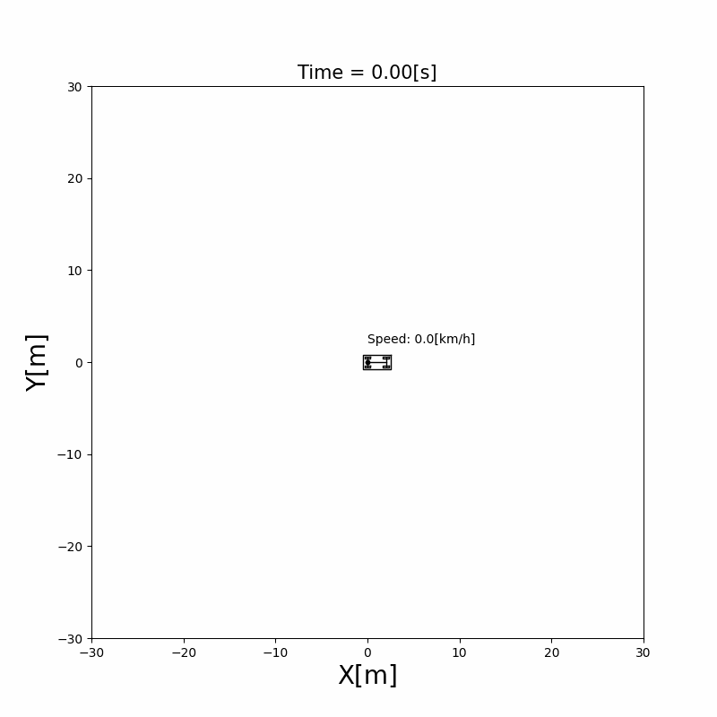

# Chapter 3: The Vehicle Model

The kinematic bicycle model explained, with its equations, derivation, discretization and Python code. To simulate a vehicle, we need equations that say how its position and heading change when it accelerates and steers. This chapter derives the **kinematic bicycle model**, the motion model that every later chapter uses: the path tracking controllers as geometry, the localization filters with noise, the planners as a constraint, and the optimal controllers in a linearized form. It then turns the model into the discrete-time update that the simulator runs, and shows where the model stops being valid.



## 3.1 The kinematic bicycle model

**Assumptions.** The model describes a car with front-wheel steering under four assumptions:

1. The vehicle moves on a plane, as a rigid body.
2. The two wheels of each axle are merged into one wheel at the center of the axle, which gives a "bicycle" with a rear and a front wheel.
3. **The wheels don't slip sideways**: each wheel moves in the direction it points.
4. The speed is controlled directly through the acceleration, without modeling the engine or the brakes.

**Geometry.** Let the wheelbase $L$ be the distance between the axles, $\delta$ the steering angle of the front wheel, and $(x, y, \theta)$ the position of the rear axle center and the yaw angle ([Chapter 2](../simulator/index.md)). Because neither wheel slips, the rear wheel moves along the body and the front wheel along its own direction, rotated by $\delta$. The lines perpendicular to the two wheels meet at one point, the **instantaneous center of rotation**, and the whole vehicle turns around it.

```{figure} figures/bicycle_model.svg
:alt: A bicycle with the rear wheel at the rear axle position and the front wheel the wheelbase L ahead, turned by the steering angle delta. Dashed lines perpendicular to the two wheels meet at the center of rotation, at distance R from the rear axle. The rear axle moves with speed v along a circle of radius R.

The kinematic bicycle model. The lines perpendicular to the wheels meet at the center of rotation, and the rear axle moves on a circle of radius $R = L / \tan\delta$.
```

The rear axle, the front axle and the center of rotation form a right triangle with the right angle at the rear axle, so the turning radius of the rear axle is

$$
R = \frac{L}{\tan\delta} \tag{1}
$$

The rear axle moves with speed $v$ along this circle, so the yaw angle changes at the rate $\dot\theta = v / R$. With the speed changed by the acceleration $a$, the model is

$$
\dot{x} = v\cos\theta, \qquad
\dot{y} = v\sin\theta, \qquad
\dot{\theta} = \frac{v\tan\delta}{L}, \qquad
\dot{v} = a \tag{2}
$$

The position moves along the heading, the heading turns faster when the vehicle is faster or the steering angle larger, and a straight wheel ($\delta = 0$) gives $R = \infty$: the vehicle goes straight.

The model is written for the **rear axle** on purpose: the rear wheel doesn't steer, so its velocity is always along the body, and the equations stay this simple. The front axle, used by the Stanley controller, is $L$ ahead along the heading.

## 3.2 Steering angle or yaw rate

The simulator of this project doesn't take the steering angle as its input. It takes the **yaw rate** $\omega = \dot\theta$ directly, with the input vector $\mathbf{u} = [a, \omega]^\top$. The two are related by (2):

$$
\omega = \frac{v\tan\delta}{L} \tag{3}
$$

so the model the simulator runs is (2) with $\dot\theta = \omega$. Controllers compute a steering angle, because that is what a driver or an actuator sets, and convert it with (3) before giving it to the vehicle (see equation (4) of the [Stanley section](../path_tracking/stanley.md)).

Both forms describe the same motion while the vehicle moves. They differ at $v = 0$: a stopped vehicle can't turn whatever the steering angle, which (3) gives as $\omega = 0$. The input of the simulator will be unified with the code roadmap ([#108](https://github.com/ShisatoYano/AutonomousVehicleControlBeginnersGuide/issues/108)).

## 3.3 From continuous to discrete time

The equations (2) are in continuous time, but the simulator moves in steps of $\Delta t$ ([Chapter 2](../simulator/index.md#22-time-and-the-simulation-loop)). The simplest way to turn them into a step is the **Euler method**: assume that the right-hand side stays constant during the step, $\mathbf{x}_{t+1} = \mathbf{x}_t + f(\mathbf{x}_t, \mathbf{u}_t)\,\Delta t$.

The simulator uses a slightly better version: during one step it keeps the heading $\theta_t$ and the acceleration $a_t$ constant, and integrates the speed exactly, so the distance traveled is $v_t \Delta t + \frac{1}{2} a_t \Delta t^2$:

\begin{equation*}
\begin{aligned}
x_{t+1} &= x_t + \left(v_t \Delta t + \tfrac{1}{2} a_t \Delta t^2\right)\cos\theta_t \\
y_{t+1} &= y_t + \left(v_t \Delta t + \tfrac{1}{2} a_t \Delta t^2\right)\sin\theta_t \\
\theta_{t+1} &= \theta_t + \omega_t \Delta t \\
v_{t+1} &= v_t + a_t \Delta t
\end{aligned} \tag{4}
\end{equation*}

Written with the state $\mathbf{x}_t = [x_t, y_t, \theta_t, v_t]^\top$, this is $\mathbf{x}_{t+1} = A(\theta_t)\,\mathbf{x}_t + B(\theta_t)\,\mathbf{u}_t$ with

$$
A(\theta_t) =
\begin{bmatrix}
1 & 0 & 0 & \Delta t\cos\theta_t \\
0 & 1 & 0 & \Delta t\sin\theta_t \\
0 & 0 & 1 & 0 \\
0 & 0 & 0 & 1
\end{bmatrix},
\qquad
B(\theta_t) =
\begin{bmatrix}
\tfrac{1}{2}\Delta t^2\cos\theta_t & 0 \\
\tfrac{1}{2}\Delta t^2\sin\theta_t & 0 \\
0 & \Delta t \\
\Delta t & 0
\end{bmatrix}
$$

This is the form the code uses (`State.motion_model()` in `src/components/state/state.py`). The matrices depend on $\theta_t$, so the model is still nonlinear; the localization filters of [Chapter 6](../localization/index.md) linearize it.

**The time step matters.** Within a step, the vehicle moves on a straight segment along $\theta_t$, while in reality it turns during the whole step. The error is small when the heading changes little in one step, that is when $\omega\,\Delta t$ is small:

```{figure} figures/discretization.svg
:alt: A circle of radius 10 m, the path of a vehicle at 5 m/s and 0.5 rad/s. The positions computed with a time step of 0.1 s stay close to the circle, while those computed with 1.0 s form a polygon that drifts off it and ends about 2 m away from the start.

One full turn at $v = 5$ m/s and $\omega = 0.5$ rad/s ($R = 10$ m), computed with (4). With $\Delta t = 0.1$ s ($\omega\Delta t = 0.05$ rad) the vehicle ends 0.17 m from where it started; with $\Delta t = 1.0$ s ($\omega\Delta t = 0.5$ rad) it ends 2.2 m away.
```

The default $\Delta t = 0.1$ s keeps $\omega\,\Delta t$ small for the speeds and curves of the simulations in this book.

## 3.4 Where the model holds

- **No slip means moderate speeds.** In a real car the tires slip sideways, more as the lateral acceleration $v^2 / R$ grows. The kinematic model is good at low speeds and gentle curves, and gets worse in fast, tight turns. [Chapter 14](../dynamic_vehicle_model/index.md) adds the tire slip with a dynamic model and compares the two.
- **No limits in the model.** The equations allow any steering angle and any acceleration. A real vehicle has a maximum steering angle (so a minimum turning radius) and limited acceleration. The simulator clamps the speed between $-10$ km/h and $60$ km/h, and stops the vehicle below $0.5$ km/h; the steering limit is left to the controllers.
- **Reverse driving.** The equations also hold for $v < 0$, driving backward. The simulator allows speeds down to $-10$ km/h.

## How later chapters use this model

| Chapter | How the model is used |
|---|---|
| [4 Following a course](../path_tracking/index.md) | As geometry: (1) and (3) relate the curve to drive to the steering angle |
| [6 Localization](../localization/index.md) | As the prediction step, (4) with noise on the input, and its Jacobians |
| [8 Planning a route](../path_planning/index.md) | As a constraint: Hybrid A* only expands motions the vehicle can drive |
| [10 Optimal control](../optimal_control/index.md) | Linearized around the course, and as the constraint of MPC |
| [14 Driving faster](../dynamic_vehicle_model/index.md) | Replaced by a dynamic model with tire slip |

The vehicle's code (its state, the drawing of its body and tires, and the specification of its size) will change with the code roadmap ([#108](https://github.com/ShisatoYano/AutonomousVehicleControlBeginnersGuide/issues/108), [#121](https://github.com/ShisatoYano/AutonomousVehicleControlBeginnersGuide/issues/121)). Its walkthrough is added to this chapter after those changes. Until then, the examples `visualize_vehicle.py` and `visualize_vehicle_zoom.py` in this folder show how a vehicle is put in the world.

## References

1. R. Rajamani, "Vehicle Dynamics and Control", 2nd ed., Springer, 2012. Chapter 2, kinematic model of lateral vehicle motion.
2. J. M. Snider, "Automatic Steering Methods for Autonomous Automobile Path Tracking", Technical Report CMU-RI-TR-09-08, Carnegie Mellon University, 2009. [PDF](https://www.ri.cmu.edu/pub_files/2009/2/Automatic_Steering_Methods_for_Autonomous_Automobile_Path_Tracking.pdf)
